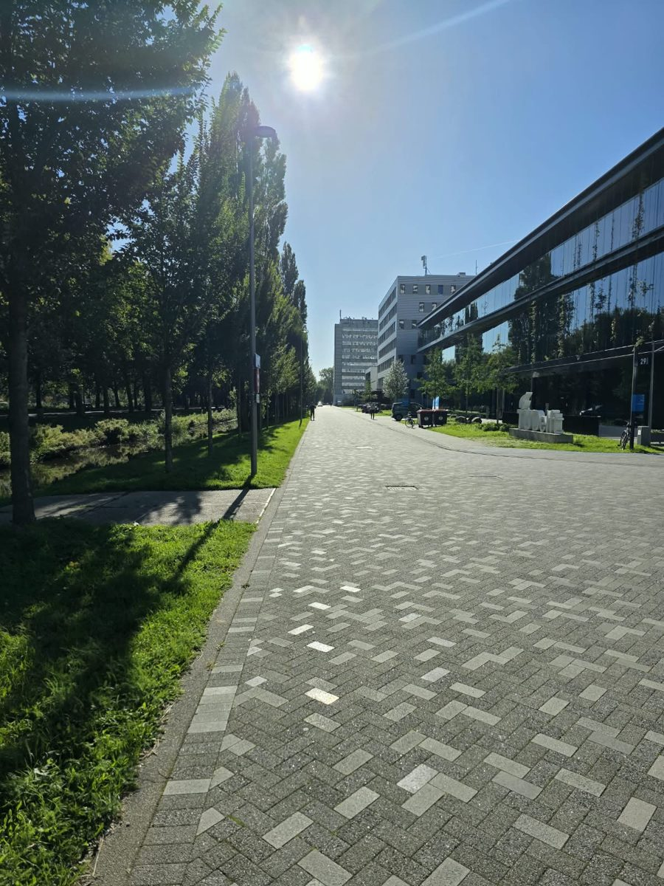

# Appendix A: Requirements

The scenarios in Section 2.4 cover the requirements that shape the architecture. The rest are listed here as user stories, grouped with MoSCoW priorities.

## Must

| As a... | I want to... | So that... |
|---|---|---|
| Crew leader | log an observation without a connection | I can report what I see wherever my crew is working |
| Crew leader | see who made each report and how long ago | I can judge how current the picture is |
| Crew leader | sync with another crew when we meet | we both know what the other has seen |
| Crew leader | see which reports conflict | we can settle them before we split up again |
| Crew leader | correct or withdraw a report my crew made | a wrong entry does not spread |
| Crew leader | receive the assignments for my crew | I know what we are expected to do next |
| Division leader | follow the reports from a wider area than one crew | I can see what is happening on the neighbouring flanks |
| Command staff | see the reports from every crew that has synced | the incident picture is built from what the field has seen |

## Should

| As a... | I want to... | So that... |
|---|---|---|
| Crew leader | see a summary after each sync | I know what my crew received and sent |
| Crew leader | see which of my reports have not been shared yet | I know what is still only on my tablet |
| Command staff | assign a crew to an area | the crew receives the reports for where it is working |
| Fire service IT | revoke a lost or stolen tablet | it can no longer sync with other tablets |

## Could

| As a... | I want to... | So that... |
|---|---|---|
| Crew leader | receive reports from crews we never met, relayed by crews we did | distance does not decide what we know |
| Investigator | replay the incident record afterwards | the incident can be reviewed and learned from |

# Appendix B: Experiment Designs in Detail

## B.1 Experiment 1: Peer-to-peer sync between two real tablets

**Setup.** Two Samsung devices from the team run the tablet app, which needs Android 14 or newer. A Galaxy S25 Ultra, a Galaxy S24, and a Galaxy Tab S8+ are available. Bluetooth and Wi-Fi are switched on, because Nearby Connections does not switch them on. One device is the sender and the other the receiver. The sender generates the events of a run, the receiver stores each event in a separate SQLite database that uses the same schema as the tablet store, and both devices write one row per run to a file.

**Variables.** A pilot at one metre with 1,000 events compares 1, 10, and 50 events per payload, because a byte payload is limited to 32 KB [<a href="#18">18</a>], and fixes the payload size for the rest. The main sweep transfers 100, 1,000, and 10,000 events at one and ten metres in line of sight, with 20 runs per combination. The interrupted runs use 1,000 events, 20 runs per case. In the first case the app on the receiver is force-stopped halfway, in the second the devices are carried out of range halfway. After each interrupted run the devices reconnect and the sender sends the whole run again.

**Measurements.**

- Time to connect: from tapping Start P2P on a device until that device shows the connection, taking the later of the two devices.
- Transfer time: from the start message of the run arriving at the receiver until the last event is stored.
- Events lost: events of the run that are missing from the receiver after the second send.
- Events duplicated: events that arrived at the receiver while it already held them. They are counted and stored once.

**Acceptance.** At least 19 of 20 runs at ten metres finish within one minute for 1,000 events, and no interrupted run loses or duplicates a stored event.

**First walking test (12 October 2026).** A Galaxy S24 and a Galaxy S25 Ultra were connected over P2P from the start, in clear line of sight with nothing between them (Figure B.1). The S24 sent severity changes continuously while its owner walked away in a straight line, until the S25 Ultra received no more of them. We estimate that this happened at about 50 to 60 metres. The distance was not measured. At that moment the S25 Ultra still showed `Connected` on its P2P tab, and the last operation it had received from the S24 was number 352. So a link can stop delivering before the app notices, which is why the experiment follows every payload to its end and does not rely on the connection status. The measured walk will repeat this with marked distances.

<figure>
  
  <figcaption><em>Figure B.1: The path of the walking test, a straight line with clear line of sight.</em></figcaption>
</figure>

## B.2 Experiment 2: The cost of a sync as the event log grows

**Logs.** For n events per tablet and an overlap o, the share of all distinct events held by both tablets, the union of the two logs holds about 2n / (1 + o) events, spread over the authors with random weights. Both tablets hold the same first part of every author's events. The rest of an author's events is held by one tablet only, alternating between the two tablets from author to author, so each tablet ends with about n events and has news for the other unless the overlap is 100 percent. An author's events are always held as an unbroken run from sequence number one, which is what lets one counter per author describe what a tablet has seen.

**Designs.** In the whole-log design each tablet sends all of its events in one message, and the receiver ignores the events it already holds. In the causal-context design each tablet first sends its causal context and then only the events the other context does not cover, which takes two rounds.

**Grid.** 2, 10, and 50 authors, 100, 1,000, 10,000, and 100,000 events per tablet, overlaps of 0, 50, 90, and 99 percent, two designs, and ten seeds, which makes 960 runs.

**Measurements.** Bytes sent, counting the serialised events as the proof of concept sends them plus the contexts, events sent, events received that were already held, rounds, and the time to decide what to send and apply it to the in-memory logs on a laptop. The time to apply the events to the tablet's SQLite store is measured on a tablet. Every run also checks that both tablets hold identical logs afterwards.

**First results.** The first run on a laptop gave the byte counts in Table B.1 and passed the identical-logs check in all 960 runs. The time to decide and apply in memory stayed below 20 ms in every combination, so on a laptop the cost of a sync is its bytes. The generated events use short report ids such as `report-7`, which gives about 104 bytes per event, so real events with longer ids will be larger.

| Overlap | Whole log (KB) | Causal context (KB) | Saved |
|---|---|---|---|
| 0% | 2,018.5 | 2,018.7 | none |
| 50% | 2,011.5 | 673.7 | 66.5% |
| 90% | 2,009.9 | 106.8 | 94.7% |
| 99% | 2,010.0 | 10.5 | 99.5% |

*Table B.1: Bytes sent for a sync with 10 authors and 10,000 events per tablet, both directions together, mean of ten seeds.*
