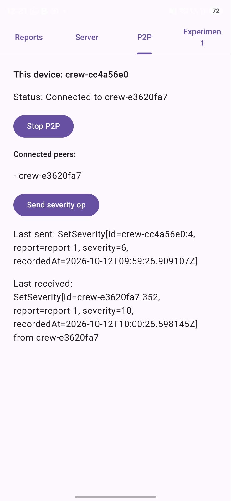

# Appendix A: Requirements

The scenarios in Section 2.4 cover the requirements that shape the architecture. The rest are listed here as user stories, grouped with MoSCoW priorities.

## Must

| As a... | I want to... | So that... |
|---|---|---|
| Crew leader | log an observation without a connection | I can report what I see wherever my crew is working |
| Crew leader | see who made each report and how long ago | I can judge how current the picture is |
| Crew leader | sync with another crew when we meet | we both know what the other has seen |
| Crew leader | see which reports conflict | we can settle them before we split up again |
| Crew leader | correct or withdraw a report my crew made | a wrong entry does not spread |
| Crew leader | receive the assignments for my crew | I know what we are expected to do next |
| Division leader | follow the reports from a wider area than one crew | I can see what is happening on the neighbouring flanks |
| Command staff | see the reports from every crew that has synced | the incident picture is built from what the field has seen |

## Should

| As a... | I want to... | So that... |
|---|---|---|
| Crew leader | see a summary after each sync | I know what my crew received and sent |
| Crew leader | see which of my reports have not been shared yet | I know what is still only on my tablet |
| Command staff | assign a crew to an area | the crew receives the reports for where it is working |
| Fire service IT | revoke a lost or stolen tablet | it can no longer sync with other tablets |

## Could

| As a... | I want to... | So that... |
|---|---|---|
| Crew leader | receive reports from crews we never met, relayed by crews we did | distance does not decide what we know |
| Investigator | replay the incident record afterwards | the incident can be reviewed and learned from |

# Appendix B: Experiment Designs in Detail

## B.1 Experiment 1: How far does the P2P link reach?

**Setup.** Two Samsung devices from the team run the tablet app. It needs Android 14 or newer. A Galaxy S25 Ultra, a Galaxy S24 and a Galaxy Tab S8+ are available. Bluetooth and Wi-Fi are on, because Nearby Connections does not turn them on. One device sends severity changes all the time. The other shows what it receives.

**First walking test (12 October 2026).** A Galaxy S24 and a Galaxy S25 Ultra were connected over P2P from the start. They were in clear line of sight, with nothing between them (Figure B.1). The S24 sent severity changes all the time. Its owner walked away in a straight line, until the S25 Ultra received no more changes. We estimate this happened at ~50-60m. We did not measure the distance. Figure B.2 is the screen of the S25 Ultra in the last moment before the connection was lost. The last change it received from the S24 was number 352.

<figure>
  
  <figcaption><em>Figure B.1: The path of the walking test, a straight line with clear line of sight.</em></figcaption>
</figure>

<figure>
  
  <figcaption><em>Figure B.2: The P2P tab of the S25 Ultra in the last moment before the connection was lost. The last operation received from the S24 is number 352.</em></figcaption>
</figure>

**Measured walk.** We repeat the walk with marked distances. We repeat it a few times. Each time we write down the distance where the changes stop arriving.

**Rule.** We keep Nearby Connections if the changes arrive at 10m.

## B.2 Experiment 2: How much data does a sync send?

**Logs.** Each pair of logs has n events per tablet. A share o of all distinct events is held by both tablets. For each author, both tablets hold the same first events. The other events of that author are held by one tablet only and the two tablets take turns from author to author. So each tablet has about n events and has news for the other tablet. The events of an author have no gaps and start at number 1. This lets one counter per author show what a tablet has seen.

**Ways to sync.** In the whole-log way, each tablet sends all its events in one message. The receiver ignores the events it already has. In the causal-context way, each tablet first sends its causal context. Then it sends only the events the other side does not have. This takes two rounds.

**Grid.** We use 2, 10 or 50 authors. Each tablet has 100, 1,000, 10,000 or 100,000 events. The tablets share 0, 50, 90 or 99% of them. We run both ways with ten random seeds. This makes 960 runs.

**Measurements.** We count the bytes sent (the events as the proof of concept sends them, plus the contexts), the events sent, the events that arrived twice and the rounds. We also measure the time on a laptop. The time to store the events in SQLite is still to be measured on a tablet. Every run checks that both tablets end with the same events.

**First results.** The first run on a laptop gave the numbers in Table B.1. In all 960 runs both tablets ended with the same events. The time on the laptop stayed below 20 ms, so on a laptop a sync costs bytes, not time. The generated events use short report ids, like `report-7`. They are about 104 bytes each. Real events with longer ids will be bigger.

| Share held by both | Whole log (KB) | Causal context (KB) | Saved |
|---|---|---|---|
| 0% | 2,018.5 | 2,018.7 | none |
| 50% | 2,011.5 | 673.7 | 66.5% |
| 90% | 2,009.9 | 106.8 | 94.7% |
| 99% | 2,010.0 | 10.5 | 99.5% |

*Table B.1: Bytes sent for a sync with 10 authors and 10,000 events per tablet, both directions together, mean of ten seeds.*
