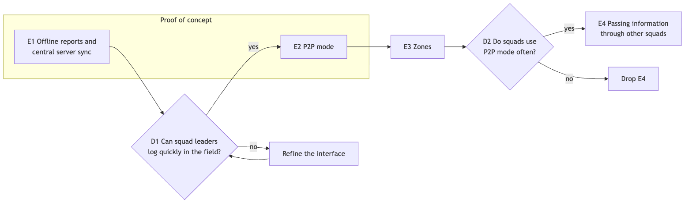

# 2. Function

<!--
DRAFT NOTES (delete before merging into the report)

Section definitions, checked by a literature search on 2026-09-19. Tags:
VERIFIED = primary text seen. TOC = chapter titles only. UNVERIFIED =
secondary source or memory. Check anything below VERIFIED before citing it.

- 2.1 Vision: neither deck defines it. The course reading has no "vision"
  chapter. The closest is Coplien & Bjørnvig, Lean Architecture, Ch. 4
  "Problem Definition" (TOC). A good problem definition states the gap between
  the current and the required state, is measurable, and is in natural,
  non-solution language (UNVERIFIED). Pitfall named in that chapter:
  "creeping featurism" (TOC).

- 2.2 Scenarios: R&W Ch. 10 "Identifying and Using Scenarios" (TOC).
  Functional vs system quality scenarios, and the fields overview / state /
  environment / stimulus / response, are UNVERIFIED. The R&W reference card on
  viewpoints-and-perspectives.info is VERIFIED: "Have you identified the
  important usage scenarios and used these to validate the system's functional
  structure?" For the quality scenario, the safer structure is Bass, Clements &
  Kazman (SAiP, 3rd ed.): source, stimulus, environment, artifact, response,
  response measure. The per-attribute "general scenario" sections are TOC; the
  field wording is UNVERIFIED.
  Cockburn: goal levels and the basic use case template are VERIFIED (read in
  full on alistair.cockburn.us). Actor, goal, trigger, main success scenario,
  extensions, stakeholders and interests.

- 2.3 ASRs: slide 21 criteria are primary. Support: SAiP Ch. 16 "Architecture
  and Requirements", ASRs captured in a utility tree (16.4) (TOC). Chen et al.,
  "Characterizing Architecturally Significant Requirements", IEEE Software 2013:
  cite the paper itself, not Wikipedia (not yet read).

- 2.4 Quality attributes: Pautasso's categories (design, operational,
  dependability & security, change, long-term) are UNVERIFIED, so check
  against the lecture. SAiP Part Two (Ch. 4 onwards) and ATAM (Ch. 21) for
  tradeoffs (TOC).

- 2.5 Roadmap: SAFe definitions VERIFIED (framework.scaledagile.com):
  Epic = "a significant solution development initiative"; Roadmap = "a schedule
  of events and milestones that forecasts and communicates planned solution
  deliverables over a time horizon"; advice to emphasise "themes, epics, or
  features instead of specific release dates". Wardley evolution stages: cite
  L05 slide 27. "Zig zagging": probably Nuseibeh's Twin Peaks model (IEEE
  Computer 2001), UNVERIFIED.

- 2.6 Pricing / sustainability: no support in the reading list. Argue it from
  L05 slides 22-23 and our own reasoning.
-->

## 2.1 Vision

Building on the problem in Section 1.1, the system is a shared incident map that crews keep using without a connection. It serves squad leaders, division supervisors, and the command staff at the Incident Command Post.

Each tablet works offline and syncs with a central server whenever a connection is available, which is also how assignments reach squads. The server sends each tablet only the reports from the zones around it. When two squads meet, their leaders can switch on P2P mode to sync directly. Some information is merged automatically, and the rest is settled by the squads on the spot.

The system serves small and large incidents alike and does not replace voice radio. Passing information on through squads that never met its author is a later step (Section 2.5).

## 2.2 Key Scenarios

Table 2.1 lists the user-goal scenarios [Cockburn] and the stakeholders from Section 1.3 they serve. Two are detailed below, followed by a quality scenario.

<!-- Actor and stakeholder names must match Section 1.3. -->

| ID | Actor | Goal | Serves |
|---|---|---|---|
| S1 | Squad leader | Log an observation without a connection | Squads |
| S2 | Squad leader | Receive updates and assignments once connected | Squads, command staff |
| S3 | Two squad leaders | Sync in P2P mode when their squads meet | Squads |
| S4 | Two squad leaders | Settle conflicting reports about the same thing | Squads |
| S5 | Division supervisor | Follow reports from a wider area than one squad | Division supervisors |
| S6 | Command staff | See the combined picture and assign squads | Command staff |

*Table 2.1: Scenario overview.*

### 2.2.1 Logging without a connection (S1)

Squad 3's leader, working below a ridge with no coverage, sees a spot fire across the containment line. They call it in over the radio, then mark it on the map, where it appears at once, marked as not yet shared until the next sync.

### 2.2.2 Two squads meet (S3, S4)

Squads 3 and 7 meet mid-shift, neither having had a connection since the morning briefing. Both leaders switch on P2P mode, and afterwards each sees a summary of what came in and what went out. Reports that do not conflict appear on both maps. Where the squads recorded conflicting things about the same item, such as a road marked blocked by one and open by the other, both tablets show both reports and the leaders settle it on the spot. Nothing either squad entered is lost.

<!-- FIGURE 2.1: timeline of this scenario (two lanes: Squad 3, Squad 7).
Export the Mermaid source to PNG so it does not count toward the word limit. -->

### 2.2.3 Quality scenario: extended disconnection

<!-- Numbers are proposals for the team to confirm; CA3 experiments measure them. -->

| Field | Content |
|---|---|
| Situation | A squad has been out of contact for a full shift, then meets another squad. |
| Response | Both tablets exchange everything they hold. No entry is lost, and conflicts are shown to both leaders. |
| Target | 500 entries per tablet exchanged within 60 seconds. |

## 2.3 Architecturally Significant Requirements

We call a requirement architecturally significant when it needs dedicated components, is costly to change, or enables or blocks future functionality [L05, slide 21].

| ID | Requirement | From | Why significant |
|---|---|---|---|
| R1 | Without a connection, a tablet can store new reports, update existing reports, and sync with another tablet in P2P mode. | S1, S3 | Every tablet holds its own copy of the record. Adding this to an online design later means a redesign. |
| R2 | With a connection, a tablet syncs with the central server automatically, sending its reports and receiving the updates and assignments for its zones. | S2, S6 | Needs a component that detects a connection and syncs without user action. |
| R3 | After two peers sync, both hold the same record. The central server counts as a peer. | S2, S3 | One sync behaviour for every pair of peers, which also enables relaying later (E4). |
| R4 | No entry is lost, and conflicting reports are shown to the users, never dropped. | S3, S4 | Detecting concurrent changes is built into the stored data, so it is costly to change once deployed (ADR in Part II). |
| R5 | Two tablets only sync when both squad leaders have switched on P2P mode. | S3 | Needs on-demand discovery and trust between tablets, and rules out background exchange. |
| R6 | The central server subscribes each tablet to the zones within a role-dependent radius of its position, or to zones it assigns, and sends it only their reports. P2P mode is not limited by zones. | S2, S5 | Needs a server component that tracks positions and subscriptions. It keeps traffic small, so the system scales from small to large incidents. |
<!-- Part II notes, not for PA2:
- Zones are Uber's H3 hexagons; subscription = all hexagons intersecting a circle of radius x around the tablet (figure available). Name H3 in CA1 or an ADR.
- ADR candidate: the server pushes updates to tablets over a persistent connection (e.g. WebSockets) instead of tablets long-polling every 30 s, because polling costs too much battery and hardware on the tablets. -->

## 2.4 Quality Attributes and Tradeoffs

Section 1.5 lists all non-functional requirements. Three qualities matter most for the scenarios above, each with a target the proof of concept can test:

| Quality | Target | From |
|---|---|---|
| Offline operation | Storing, updating and P2P sync work for a full operational period (12 hours) without the central server. | R1, R5 |
| No lost reports | Zero lost. A stored report survives crashes and interrupted syncs, and reaches the central server at the next sync. | R3, R4 |
| Visible report age | Every report shows its author and age, on every tablet. | R1, R2 |

<!-- The 12-hour target is a proposal for the team to confirm. -->

**Tradeoff: manual P2P mode against spread of data.** Because leaders sync only when they choose to, reports reach other squads later than they would with automatic exchange. We accept this in return for lower battery use and for leaders keeping control over whom they sync with.

<!-- CONFIRM: are battery use and control the team's actual reasons for the manual toggle? -->

## 2.5 Delivery Roadmap

The roadmap (Figure 2.2) orders epics, sets of user stories that together bring value [L05, slide 20], over one to two years and without dates [SAFe]. Each epic includes both the interface and what runs behind it.

*Figure 2.2: Delivery roadmap. E1 and E2 are built in the proof of concept.*

<!-- Source: figures/roadmap.mmd. Re-render with mmdc after changes. -->

| Epic | The squad leader gets | Delivers | Serves | Value measured by |
|---|---|---|---|---|
| E1 | An offline map for logging reports, with sync to the central server | R1–R4 | Squads, command staff | Reports logged offline per shift |
| E2 | P2P mode, a sync summary and a view for settling conflicts | R1, R5 | Squads | P2P syncs per shift |
| E3 | Reports from the zones around them | R6 | Division supervisors | Data sent per tablet |
| E4 | Reports relayed by squads that met their author | R3 | Squads | Time for a report to reach squads |
| E5 | Links to regional systems | none | Command staff | To be defined |

*Table 2.2: Epics.*

At D1, field trials check that squad leaders can log quickly with gloves on. If not, the interface is refined before E2. At D2, E4 is built only if squads use P2P mode often, since relaying depends on it.

## 2.6 Pricing and Sustainability

Governments buy through their fire services on yearly budgets and multi-year contracts. Of the models in L05 (slide 23), a yearly subscription per fire service, priced per tablet, therefore fits best, as it does for comparable tools [Avenza], [Esri]. The alternative is TAK's model: built at government expense and given to responders for free [CivTAK]. A subscription needs license management on the central server, but a lapsed license must never stop a tablet in the field, so it is only checked when a tablet syncs with the server. Squads gain their neighbours' reports, command staff a combined picture, and fire services a predictable cost. The cost to crews, being located through their tablets, is discussed in Section 1.3.

<!-- Sources (verified by the pricing research, 2026-09-19):
[Avenza] https://store.avenza.com/pages/pricing (Pro $169.99/device/yr; enterprise volume pricing)
[Esri] https://www.esri.com/en-us/arcgis/products/arcgis-field-maps/buy (bundled in user-type licenses)
[CivTAK] https://www.civtak.org/atak-about/ ("developed at government expense")
Also verified: Technosylva $383k California RFI2 contract, https://statescoop.com/california-wildfire-technology-contracts-fast-procurement/
Full research: scratchpad pricing_research.md. Tablet Command contract amounts are UNVERIFIED, so don't cite them. -->
