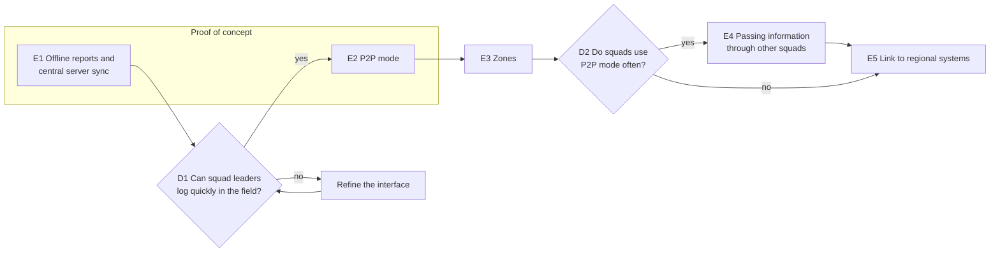

# 2. Function

<!--
DRAFT NOTES (delete before merging into the report)

Section definitions, checked by a literature search on 2026-09-19. Tags:
VERIFIED = primary text seen. TOC = chapter titles only. UNVERIFIED =
secondary source or memory. Check anything below VERIFIED before citing it.

- 2.1 Vision: neither deck defines it. The course reading has no "vision"
  chapter. The closest is Coplien & Bjørnvig, Lean Architecture, Ch. 4
  "Problem Definition" (TOC). A good problem definition states the gap between
  the current and the required state, is measurable, and is in natural,
  non-solution language (UNVERIFIED). Pitfall named in that chapter:
  "creeping featurism" (TOC).

- 2.2 Scenarios: R&W Ch. 10 "Identifying and Using Scenarios" (TOC).
  Functional vs system quality scenarios, and the fields overview / state /
  environment / stimulus / response, are UNVERIFIED. The R&W reference card on
  viewpoints-and-perspectives.info is VERIFIED: "Have you identified the
  important usage scenarios and used these to validate the system's functional
  structure?" For the quality scenario, the safer structure is Bass, Clements &
  Kazman (SAiP, 3rd ed.): source, stimulus, environment, artifact, response,
  response measure. The per-attribute "general scenario" sections are TOC; the
  field wording is UNVERIFIED.
  Cockburn: goal levels and the basic use case template are VERIFIED (read in
  full on alistair.cockburn.us). Actor, goal, trigger, main success scenario,
  extensions, stakeholders and interests.

- 2.3 ASRs: slide 21 criteria are primary. Support: SAiP Ch. 16 "Architecture
  and Requirements", ASRs captured in a utility tree (16.4) (TOC). Chen et al.,
  "Characterizing Architecturally Significant Requirements", IEEE Software 2013:
  cite the paper itself, not Wikipedia (not yet read).

- 2.4 Quality attributes: Pautasso's categories (design, operational,
  dependability & security, change, long-term) are UNVERIFIED, so check
  against the lecture. SAiP Part Two (Ch. 4 onwards) and ATAM (Ch. 21) for
  tradeoffs (TOC).

- 2.5 Roadmap: SAFe definitions VERIFIED (framework.scaledagile.com):
  Epic = "a significant solution development initiative"; Roadmap = "a schedule
  of events and milestones that forecasts and communicates planned solution
  deliverables over a time horizon"; advice to emphasise "themes, epics, or
  features instead of specific release dates". Wardley evolution stages: cite
  L05 slide 27. "Zig zagging": probably Nuseibeh's Twin Peaks model (IEEE
  Computer 2001), UNVERIFIED.

- 2.6 Pricing / sustainability: no support in the reading list. Argue it from
  L05 slides 22-23 and our own reasoning.
-->

## 2.1 Vision

In response to the problem in Section 1.1, the system is a shared incident map that crews keep using without a connection. It serves squad leaders and crew bosses who log observations in the field, division supervisors who need to know what neighbouring crews have seen, and the command staff at the Incident Command Post, who build the incident picture from their reports.

Each device keeps working offline and synchronises with a central server whenever a connection is available, which is also how updates and assignments from the command staff reach the squads. The incident area is divided into zones, and each tablet receives from the central server only the reports from the zones around it. When two squads meet, their leaders can switch on P2P mode to bring each other up to date. Some information is combined automatically. The rest is settled by the squads on the spot.

The system is meant for small and large incidents alike. It does not replace voice radio, model fire behaviour or direct aircraft. Passing information on through squads that never met its author is a later step (Section 2.5).

## 2.2 Key Scenarios

We describe the system's function through scenarios written from the user's side, at the level of one person reaching one goal [Cockburn]. Table 2.1 lists them with the stakeholders from Section 1.3 they serve. Two functional scenarios and one quality scenario are worked out below.

<!-- Actor and stakeholder names must match Section 1.3. -->

| ID | Actor | Goal | Stakeholders served |
|---|---|---|---|
| S1 | Squad leader | Log an observation without a connection | Squads, division supervisors |
| S2 | Squad leader | Receive updates and assignments for the zones around them once the tablet reaches the central server | Squads, command staff |
| S3 | Two squad leaders | Sync their tablets in P2P mode when their squads meet | Squads, division supervisors |
| S4 | Two squad leaders | Settle conflicting reports about the same thing | Squads |
| S5 | Division supervisor | Follow reports from a wider area than a single squad | Division supervisors |
| S6 | Command staff | See the combined incident picture and send assignments to squads | Command staff |
| S7 | Squad leader | Correct or withdraw their own wrong entry | Squads |

*Table 2.1: Scenario overview.*

### 2.2.1 Logging an observation without a connection (S1)

Squad 3 is working below a ridge with no coverage when the squad leader sees a spot fire across the containment line. They call it in over the radio, then mark it on the tablet map. It appears on their map straight away, marked as not yet shared, and is sent at the next exchange, with the central server or with another squad.

### 2.2.2 Two squads meet (S3, S4)

Squad 3 and Squad 7 meet during the shift. Neither has had a connection since the morning briefing. Both squad leaders switch on P2P mode, and each tablet shows the other squad. Afterwards, each leader sees a summary of what came in and what went out. Reports that do not conflict now appear on both maps. Where the squads recorded conflicting things about the same item, such as one marking a road as blocked and the other as open, both tablets show the conflict with both reports, and the two leaders settle it on the spot.

*Success guarantee:* both tablets hold the same record, and nothing either squad entered has been lost.

<!-- FIGURE 2.1: timeline of this scenario (two lanes: Squad 3, Squad 7).
Export the Mermaid source to PNG so it does not count toward the word limit. -->

### 2.2.3 Quality scenario: extended disconnection

<!-- Numbers are proposals for the team to confirm; CA3 experiments measure them. -->

| Field | Content |
|---|---|
| Situation | A squad has been out of contact for a full shift, then meets another squad. |
| Required response | Both tablets exchange everything they hold. No entry is lost, and conflicting reports are shown to both leaders, never dropped. |
| Target | 500 entries per tablet are exchanged within 60 seconds. |

## 2.3 Architecturally Significant Requirements

Not every requirement shapes the architecture. We treat a requirement as architecturally significant when it needs dedicated components, is costly to change later, or enables or blocks future functionality [L05, slide 21]. Six requirements from Section 2.2 meet at least one of these criteria.

| ID | Requirement | Scenarios | Why it is significant |
|---|---|---|---|
| R1 | Without a connection, a tablet can store new reports, update existing reports, and sync with another tablet in P2P mode. | S1, S3, S7 | Each tablet must hold its own copy of the incident record. Adding offline support to a system designed to be online means redesigning it, so this has to be decided first. |
| R2 | With a connection, a tablet syncs with the central server automatically, sending its new and updated reports and receiving the updates and assignments for the zones around it. | S2, S6 | Unlike P2P mode, this sync needs no user action, so the tablet must notice when a connection appears and sync on its own. |
| R3 | After two peers sync, both hold the same record. The central server counts as a peer. | S2, S3, S6 | Every sync, whether between two tablets or between a tablet and the central server, follows the same behaviour, not two separate mechanisms. This also makes the later step of passing information on through other squads possible (Section 2.5). |
| R4 | No entry is lost, and conflicting reports are shown to the users, never dropped. | S3, S4 | Every copy of the record must be able to tell that two changes were made without knowledge of each other. This is built into how data is stored and exchanged, so it is costly to change once tablets are in the field. How this is done is decided in an ADR in Part II. |
| R5 | Two tablets only sync when both squad leaders have switched on P2P mode. | S3 | Tablets need a way to find and trust each other only when asked to, which is a dedicated component. It also rules out exchanging data in the background without anyone asking. |
| R6 | Each tablet reports its position to the central server, which subscribes it to every zone within a radius around that position and sends it only the reports from those zones. The radius depends on the user's role, so a division supervisor follows a wider area than a squad. The server can also subscribe a tablet to specific zones, for example when assigning a squad to an area. Zones limit only what the server sends: two tablets in P2P mode exchange everything they hold. | S2, S5 | This needs a dedicated component on the server that tracks positions, zones and subscriptions. It keeps the data sent to each tablet small on weak connections, which lets the same system serve small and large incidents. Because it decides what every sync with the server contains, it is costly to change later. |
<!-- Part II notes, not for PA2:
- Zones are Uber's H3 hexagons; subscription = all hexagons intersecting a circle of radius x around the tablet (figure available). Name H3 in CA1 or an ADR.
- ADR candidate: the server pushes updates to tablets over a persistent connection (e.g. WebSockets) instead of tablets long-polling every 30 s, because polling costs too much battery and hardware on the tablets. -->

The remaining scenarios, such as viewing a division's reports (S5) or correcting an entry (S7), are features of the map and do not constrain the architecture beyond R1 and R2.

## 2.4 Quality Attributes and Tradeoffs

Section 1.5 lists the non-functional requirements across all categories. Here we go deeper into the three qualities that matter most for the scenarios in Section 2.2, and give each a target that the proof of concept can test.

| Quality | What it means | Target | Requirements |
|---|---|---|---|
| Offline operation | A squad can store and update reports and sync in P2P mode with no connection. | A full operational period (12 hours) with no connection to the central server. | R1, R5 |
| No lost reports | Once stored on a tablet, a report survives a crash or an interrupted sync and reaches the central server at the next sync. | Zero reports lost. | R3, R4 |
| Visible report age | Every report on the map shows who made it and how long ago. | Every report, on every tablet. | R1, R2 |

<!-- The 12-hour target is a proposal for the team to confirm. -->

**Tradeoff: manual P2P mode against wide spread of data.** Because P2P mode is only switched on when two squad leaders choose to, reports spread between squads only at planned meetings. A report can therefore take longer to reach other squads than it would if tablets exchanged data automatically whenever they came close. We accept this delay in return for lower battery use and for squad leaders keeping control over which tablets they exchange data with.

<!-- CONFIRM: are battery use and control the team's actual reasons for the manual toggle? -->

## 2.5 Delivery Roadmap

We plan delivery as a series of epics, each a set of user stories that together bring clear value [L05, slide 20], over a horizon of one to two years. Each epic delivers both what the squad leader sees and what runs behind it, since neither is useful alone. Figure 2.2 shows the order and the points where we decide whether to continue, and Table 2.2 links each epic to the requirements it delivers and the stakeholders it serves. Following SAFe's advice to show epics rather than release dates [SAFe], the roadmap has no fixed dates.

*Figure 2.2: Delivery roadmap. E1 and E2 are built in the proof of concept.*

| Epic | What the squad leader gets | Requirements | Serves | Value measured by |
|---|---|---|---|---|
| E1 | A map to log and update reports offline, with a "not yet shared" marker and the age of each report. Reports sync with the central server when a connection appears. | R1, R2, R3, R4 | Squads, command staff | Reports logged offline per shift |
| E2 | A P2P mode switch, a list of tablets in range, a summary after each sync, and a view for settling conflicts. | R1, R5 | Squads | P2P syncs per shift, conflicts settled on the spot |
| E3 | Reports from the zones around the tablet, with a wider area for division supervisors. | R6 | Division supervisors, command staff | Data sent per tablet |
| E4 | Reports from squads they never met, passed on by squads that did. | R3 | Squads | Time for a report to reach squads out of contact |
| E5 | Incident information shared beyond a single central server. | none | Command staff | To be defined |

*Table 2.2: Epics.*

At D1, after the first field trials, we check whether squad leaders can log a report quickly with gloves on and under stress. If not, we refine the interface before building P2P mode on top of it. At D2 we check how often squads actually use P2P mode. Passing information through other squads (E4) only pays off if P2P syncs are common, so if they are rare, we drop E4 and move on to E5.

## 2.6 Pricing and Sustainability

The buyers are governments, through their fire services. They budget yearly and buy software as multi-year contracts, so of the pricing models in L05 (slide 23) a yearly subscription per fire service, priced by the number of tablets, fits best. Comparable field tools are sold the same way: Avenza Maps charges per device per year [Avenza], and Esri sells Field Maps as part of per-user licenses [Esri]. The main alternative is the model of TAK, which is developed at government expense and given to responders for free [CivTAK]. That shifts the cost to a single government funder instead of each fire service.

A subscription needs license management on the central server. It must never block a tablet in the field: if a subscription lapses during an incident, tablets keep logging reports and syncing in P2P mode (R1), and the license is only checked when a tablet syncs with the central server.

Each stakeholder gains something. Squads see what neighbouring squads have reported, command staff get a combined picture, and fire services get a cost that fits their yearly budget. The one loss, crews being located through their tablets (R6), is the tension already discussed in Section 1.3.

<!-- Sources (verified by the pricing research, 2026-09-19):
[Avenza] https://store.avenza.com/pages/pricing (Pro $169.99/device/yr; enterprise volume pricing)
[Esri] https://www.esri.com/en-us/arcgis/products/arcgis-field-maps/buy (bundled in user-type licenses)
[CivTAK] https://www.civtak.org/atak-about/ ("developed at government expense")
Also verified: Technosylva $383k California RFI2 contract, https://statescoop.com/california-wildfire-technology-contracts-fast-procurement/
Full research: scratchpad pricing_research.md. Tablet Command contract amounts are UNVERIFIED, so don't cite them. -->
