

### CS4505 Software Architecture Swan Report
# Firefly

**Group 67**

Rares Andrei Popa

Stefan Claudiu Avram

Alexandru Cristian Cazacu

Mihai Ciorascu

Radu-Andrei Zidaru

## Table of Contents

- [1. Introduction](#1-introduction)
- [2. Problem and Context Analysis](#2-problem-and-context-analysis)
  - [2.1 Problem Description](#21-problem-description)
  - [2.2 Context View](#22-context-view)
  - [2.3 Stakeholders](#23-stakeholders)
  - [2.4 Wardley Map](#24-wardley-map)
  - [2.5 Example Scenarios](#25-example-scenarios)
  - [2.6 Architecturally Significant Requirements](#26-architecturally-significant-requirements)
  - [2.7 Quality Attributes](#27-quality-attributes)
  - [2.8 Roadmap and Pricing](#28-roadmap-and-pricing)
  - [2.9 Ethical and Legal Considerations](#29-ethical-and-legal-considerations)
- [3. Architecture](#3-architecture)
  - [3.1 Components](#31-components)
  - [3.2 Event-Based Domain Model](#32-event-based-domain-model)
  - [3.3 Elaborating Field Reporting](#33-elaborating-field-reporting)
  - [3.4 Container View](#34-container-view)
  - [3.5 Component View](#35-component-view)
  - [3.6 Code View](#36-code-view)
  - [3.7 Runtime Views](#37-runtime-views)
  - [3.8 Deployment View](#38-deployment-view)
  - [3.9 Architectural Decisions](#39-architectural-decisions)
  - [3.10 How This Connects to Chapter 2](#310-how-this-connects-to-chapter-2)
- [4. Architectural Decision Records](#4-architectural-decision-records)
  - [4.1 ADR 1: How Events Travel from Device to Server](#41-adr-1-how-events-travel-from-device-to-server)
  - [4.2 ADR 2: How Reports Travel from Server to Device](#42-adr-2-how-reports-travel-from-server-to-device)
  - [4.3 ADR 3: How Events are Authenticated](#43-adr-3-how-events-are-authenticated)
  - [4.4 ADR 4: How a Conflict Is Resolved](#44-adr-4-how-a-conflict-is-resolved)
- [5. Proof of Concept](#5-proof-of-concept)
  - [5.1 What It Has to Show](#51-what-it-has-to-show)
  - [5.2 What We Built](#52-what-we-built)
  - [5.3 How an Edit Travels](#53-how-an-edit-travels)
  - [5.4 How We Checked It](#54-how-we-checked-it)
  - [5.5 Where It Differs from the Architecture](#55-where-it-differs-from-the-architecture)
  - [5.6 What Building It Taught Us](#56-what-building-it-taught-us)
- [6. Architectural Experiments](#6-architectural-experiments)
  - [6.1 Experiment 1: How far does the P2P link reach?](#61-experiment-1-how-far-does-the-p2p-link-reach)
  - [6.2 Experiment 2: How long does a sync take?](#62-experiment-2-how-long-does-a-sync-take)
  - [6.3 Limits and next steps](#63-limits-and-next-steps)
- [References](#references)

## 1. Introduction

Climate change has made major natural disasters common. First responders often work in situations that go far beyond normal operations, with unreliable or no connectivity for long stretches. Supervisors face heavy workloads where lives are at stake, made worse because radio communications used to issue orders also have to carry field reports up the command chain. Chapter 2 explores this problem in more detail.

We propose Firefly, an app that lets emergency personnel record and edit incident reports from the field. The system works offline: personnel can create and edit reports with no connection, and a backend merges conflicting edits once connectivity returns. Since more than one person can edit the same report while offline, we designed a conflict-resolution policy that avoids losing safety-critical information. We also added peer-to-peer sync between devices that are near each other, so personnel get the most complete picture even with low connectivity.

Chapter 3 covers the architecture. Chapter 4 records three architectural decisions. Chapter 5 describes the proof of concept, and Chapter 6 two experiments run on it. Section 2.8 covers the roadmap.

## 2. Problem and Context Analysis

### 2.1 Problem Description

During large-scale disaster response, radio channels quickly get overloaded with both field reports and orders, which leads to mismanagement: congested frequencies and a broken command structure during the Pacific Palisades Fire (2025) [<a href="#1">1</a>][<a href="#2">2</a>][<a href="#3">3</a>], and a public dispute over resources during the Gironde wildfires in France (2026). [<a href="#5">5</a>][<a href="#6">6</a>]

This overload also falls on the small group coordinating the response. Overworking them can be disastrous: in the 2002 Überlingen mid-air collision, one air traffic controller managing two positions alone failed to separate two aircraft in time, killing all 71 people aboard. [<a href="#4">4</a>]

Firefly lets field workers share incident reports even when the usual channels are overloaded, merging conflicting reports where possible so effort during a disaster response is not wasted.

### 2.2 Context View

The Context View shows the boundary between the system and its environment. As the lecture puts it, "you design the system, the context is a given" [<a href="#11">11</a>].

Firefly's scope is to keep field reports in sync, so every device ends up with the same complete record, connected or not. The boundary is the Incident Command Post: the server is a physical machine at the ICP, not a cloud endpoint, going beyond it is future work. Voice radio and crew assignment stay human decisions, outside our scope. Our job is narrower: make sure command staff act on one complete record, not a partial picture.

Crew leaders use tablets and record offline by default. A device syncs automatically when it reconnects, either to the ICP or to another tablet. Division leaders and command staff see the current zone-scoped record through the ICP server. When two crews meet, their leaders can opt in to peer-to-peer sync, so tablets never exchange data without the crews knowing.

Two existing tools show this gap. ArcGIS Field Maps lets crews edit offline, but its sync "has no awareness of conflict management" and follows a "last in, wins" model, so whichever device syncs last overwrites an earlier edit to the same feature, and keeping users from overwriting each other is left to planning [<a href="#20">20</a>][<a href="#21">21</a>]. ATAK paired with mesh radios such as goTenna or Meshtastic works with no network at all, but it only forwards messages: positions, map markers and chat are each sent over the mesh as they are made [<a href="#22">22</a>][<a href="#23">23</a>], and neither describes a way to reconcile two crews' different reports of the same thing. Our problem, merging concurrent offline edits to the same record, sits between the two.

We depend on GPS accuracy for zone subscription, covered more in the Wardley Map below and in Section 3.1. A fire-authority record system and a weather feed are future work, named here only so the figure stays accurate.

<figure>
  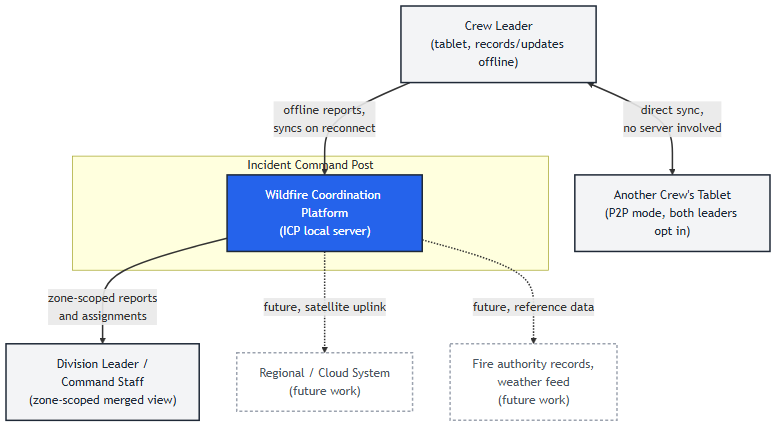
  <figcaption><em>Figure 1: Context view. The system boundary is the ICP local server. Regional/cloud reach and external record systems are dashed, future work only.</em></figcaption>
</figure>

### 2.3 Stakeholders

Stakeholders fall into five categories. Field workers (firefighters, crew leads) create and edit reports and have the most direct contact with the system, but no formal power over its design. Command and decision-making staff, like incident commanders or EOC personnel, consume the merged view and are the main reason the system exists, together with the owning agency, such as a regional fire service, which controls procurement, deployment, and data governance. Above them sit government and regulatory bodies, such as national ministries or data protection regulators. They hold high power, set policy and funding, and are not always aligned with the owning agency. Platform developers design and improve the system. Indirectly affected parties, such as civilians named in reports or any oversight body, have a stake without using the system directly.

Plotting each stakeholder on a Power/Interest grid shows which of them deserve the most focus, and highlights possible conflicts.

<figure>
  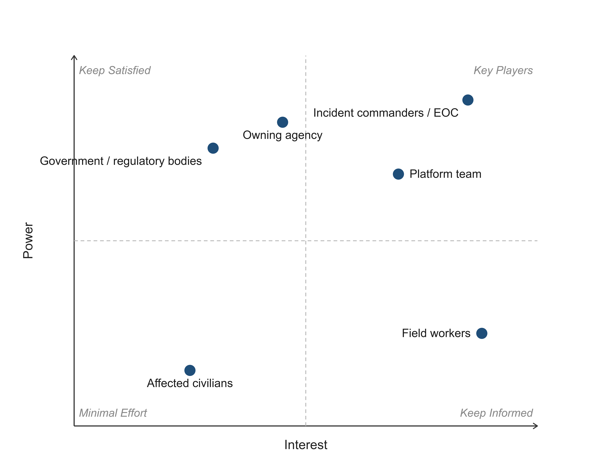
  <figcaption><em>Figure 2: Power-Interest Grid for Stakeholders</em> </figcaption>
</figure>

### 2.4 Wardley Map

A Wardley map puts the user and the key system parts on two axes: value visible to the user, and evolution stage, from Genesis, "uncertainty about everything, including functionality," through Custom built and Product, to Commodity, "as standard as water and electricity" [<a href="#11">11</a>]. The map itself is not the point, what it shows is where our effort should go.

Field Reporting is the merge logic that solves concurrent offline edits (Chapter 3). It sits alone in the genesis, high-value quadrant. No existing tool merges concurrent edits correctly for this problem (Section 2.2), and this decides whether Firefly's core promise, no edit ever disappears, actually holds. Zone Subscription is still fairly custom, we chose its radius-based H3 subscription on purpose to avoid an edge-of-hexagon blind spot, but it gives less direct value than the merge logic. Synchronization sits closer to the middle, custom-built for us but kept free of wildfire-specific logic, so it stays reusable. Device Identity, the tablet hardware, and the local WiFi or Bluetooth stack all sit near commodity, well-understood pieces we can just treat as given.

The map can change. If H3 tools become something everybody uses, Zone Subscription could move toward product. Field Reporting stays in genesis only as long as no one else solves this merge problem, a real competitor would force us to redraw the map.

<figure>
  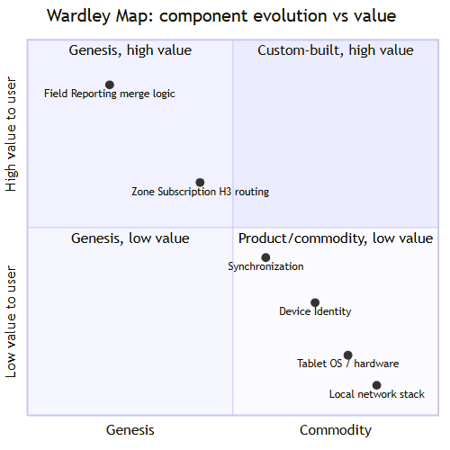
  <figcaption><em>Figure 3: Wardley map of the system's main components. Field Reporting is the one genesis-stage, high-value component, matching its identification as the core domain in Chapter 3.</em></figcaption>
</figure>

### 2.5 Example Scenarios

To show how the system works in practice, this section presents four scenarios at user-goal level [<a href="#8">8</a>]: working with a connection, logging without one, two crews meeting, and coming back into coverage. These scenarios cover the requirements that shape the architecture. The remaining requirements are in Appendix A, as user stories.

- **Working with a connection**: Alice leads a crew on the eastern flank. She marks a blocked access road on her tablet, and it shows up on the command staff's map at the Incident Command Post. Reports from nearby crews appear on her map too, each one naming the crew and time. When command staff assign her crew for the next shift, the assignment arrives the same way, though anything urgent still comes over the radio. Reports from crews on the far side of the fire never reach her tablet, since they are of no use to her.

- **Logging without a connection**: Alice's crew moves below a ridge and loses coverage. She sees a spot fire across the containment line, calls it in on the radio, then marks it on her map with its size and direction. Her tablet keeps the report with her name and the time, and she keeps logging through the afternoon from the map she had when the signal went.

- **Two crews meeting**: Alice's crew runs into Bob's crew later that day. Neither has had a connection since morning, so they switch on P2P mode. Each tablet shows the other crew, and once the sync finishes, each of them sees a summary of what came in and out. Almost everything lands on both maps, except conflicting logs: Alice had marked one road blocked, Bob had marked it open. Both tablets show the road with both reports, who made them and when, and Alice and Bob settle it themselves before splitting up again, so neither report is thrown away.

- **Coming back into coverage**: Bob drives back to the staging area and his tablet picks up a signal, syncing with the central server. Everything his crew logged that day, along with what he took from Alice, reaches command staff. In return, his tablet receives the reports it missed for the zones around him.

### 2.6 Architecturally Significant Requirements

Not every requirement shapes the architecture. We treat one as architecturally significant if it needs dedicated components, is expensive to change later, or affects future functions [<a href="#7">7</a>]. Six requirements meet at least one of these.

- **R1, working without a connection.** A tablet can store new reports, update existing ones, and sync in P2P mode while offline. Each tablet keeps its own copy of the record, so it can work without reading from a server. This is also the hardest requirement to add later, assuming a live connection first would mean designing the system twice.

- **R2, syncing with the central server.** When a tablet has a connection, it syncs on its own, sending its reports and receiving updates and assignments for its zones. This happens without anyone asking, so a component has to notice the connection and act on it.

- **R3, single sync behaviour.** After two peers sync, both hold the same record, and the central server counts as a peer too. One behaviour covers every pair, and a tablet passes on what it received as readily as what its own crew recorded, so a report can reach a crew that never met its author.

- **R4, no silent loss.** No report is lost. This shapes how reports are stored and exchanged, and is expensive to change once tablets are in the field. Section 3's architectural decisions cover how.

- **R5, P2P mode under the users' control.** Two tablets only sync once both crew leaders switch P2P mode on. Tablets must find and trust each other on request, which rules out exchanging data in the background whenever two tablets pass each other.

- **R6, zones.** A tablet subscribes to the zones within a radius of its position, or to zones assigned to it, and receives only reports from those zones. Zones do not limit P2P mode, where two tablets exchange everything they hold.

### 2.7 Quality Attributes

Several quality attributes were prioritised while designing the system. Each describes how the system behaves, and each has a target the proof of concept can measure.

- **Availability under partition.** Nothing is withdrawn when the connection goes. A tablet offers what it offers when connected for a full twelve-hour operational period, even offline. A tablet that needs the server for its map is useless below a ridge, which is what R1 pays for.

- **Reliability.** A report the tablet has accepted survives a crash, a flat battery, and a sync cut off halfway, the system never discards it. The target is zero loss across the interruptions the experiments inject, since nobody can ask for a report they never knew was made.

- **Scalability.** The volume a tablet receives stays roughly constant as an incident grows from one crew to dozens, and the central server absorbs the shift-change surge, when a whole division comes back into coverage within minutes carrying twelve hours of reports each. These are the targets the beta phase measures (Section 2.8).

- **Compatibility across versions.** Tablets and servers one version apart still sync. Agencies upgrade on their own schedule, so mutual aid puts different-vintage devices on the same fire, and sync cannot assume both sides are current.

These attributes fight each other sometimes. Compatibility across versions holds back Scalability, because the server cannot always pick the fastest sync path, it also has to work with an older tablet still in the field. Reliability and Availability under partition do not fight each other though. They come from the same idea: a tablet keeps its own full copy, so it never needs the server to stay useful.

### 2.8 Roadmap and Pricing

To make the future concrete, we laid it out as a roadmap of four phases over a horizon of one to two years. The roadmap carries no dates, since development time is impossible to estimate without knowing team size, so it names what each phase delivers rather than when it ships.

The **proof of concept** is the phase we build during this course (Chapter 5). It is deliberately narrow: the offline map, syncing with the central server, and P2P mode between two tablets. It is not deployed to anyone, its purpose is to show that a tablet stays useful with no connection and that two tablets can reconcile what they did apart.

The **minimum viable product** puts the system in the hands of one fire service, on real incidents alongside the radio. It adds the first working interface: a map for logging and reading reports, and zones, so a crew receives what belongs to the ground it works on. A decision point sits before this phase, shown in Figure 4: field trials have to show a crew leader can log a report quickly with gloves on and a fire in front of them, otherwise the interface gets reworked first.

The **beta** widens the same fire service from one crew to a whole incident: every crew, their division leaders, and command staff reading the incident picture. Where the MVP shows the system works for the crew that carries it, the beta shows it holds under a full operational period of reports at once, the first point zones and sync face real load.

**Release 1.0** adds mutual aid across agencies and a reworked interface on both fronts: the tablet map crews use, and a web client for command staff at a desk. Two fire services on the same fire each run their own server, and reports from one agency's tablets must reach the other's crews, whose devices may be on a different version. From here the system serves a whole incident across organisations, and licensing and support begin.

<figure>
  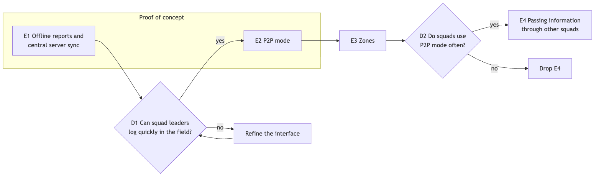
  <figcaption><em>Figure 4: Delivery roadmap. Only the proof of concept is built during this course.</em></figcaption>
</figure>

Fire services will not hand live crew positions to a server we run, so the system is sold as a licence deployed on the customer's own infrastructure. Of the models in [<a href="#7">7</a>] this is a subscription, but an annual one for self-hosted software, matching how self-hosted enterprise products have moved from perpetual licences to yearly terms [<a href="#10">10</a>]. It is priced per agency, since the number of tablets swings with the season and with mutual aid. The MVP is free, so a fire service can run it for one season without procurement, and the licence begins at release 1.0. Annual support is priced as a percentage of the licence fee, in line with common industry practice [<a href="#9">9</a>]. Deployment and integration are charged separately.

Every agency hosts its own server and upgrades on its own schedule, so release 1.0's mutual aid has to work between different versions, which falls on R3. Crews, command staff, and fire services all gain from the system.

### 2.9 Ethical and Legal Considerations

- Automation bias. A commander who sees a report marked "merged successfully" may stop treating it as provisional. Since the system's whole premise is reconciling conflicting edits without asking a human every time, the UI must keep showing that a report was auto-merged, not just that it was saved. Presenting a merge as more certain than it is would undermine the trust the project depends on, and the solution must never lose information that might be safety critical.
- False or spoofed reports. A system built to keep working through network chaos is also an attractive target for someone who wants to inject false data during that same chaos. Access must be safeguarded by modern user/device authentication.
- Privacy of people named in reports. Reports tied to a location may include personal data such as injuries, missing persons, or property loss. This is sensitive personal data under regulations like the GDPR, which constrains retention, who can access merge history, and how long pre-merge versions should be kept.
- Equity across device capability. Not every field worker or agency has the newest hardware. The implementation must be lean and performance-optimised so it runs on a wide range of devices.

## 3. Architecture

### 3.1 Components

A bounded context is where one specific domain model and its own language apply [<a href="#7">7</a>]. We split the system into four bounded contexts, all ours to build, plus external systems we do not control.

**Field Reporting** is our core domain, it owns what a report and an incident are, and how concurrent edits get merged. This is the one genesis-stage piece in Wardley terms (the Wardley Map, Section 2.4). **Synchronization** moves events between devices and the server, generic enough for both the server path and the peer-to-peer path. **Zone Subscription** maps report locations and tablet positions to H3 hexagons to route server-path deliveries, it has no role in peer-to-peer mode, by design. **Device Identity** gives each tablet a stable id, used in every event's causal stamp.

*External, not built in this proof of concept*: a future fire-authority record system, a weather feed, and the regional or cloud layer above the ICP server (Section 2.2).

| Upstream | Downstream | Relationship |
|---|---|---|
| Field Reporting | Synchronization | Customer/Supplier, Field Reporting defines what needs merging. |
| Field Reporting | Zone Subscription | Customer/Supplier, only report locations are read. |
| Zone Subscription | Synchronization | Customer/Supplier, server path only. |
| Device Identity | Field Reporting, Synchronization | Customer/Supplier, both consume a stable device id. |
| Field Reporting | External systems | Anti-corruption layer, once built, to shield our model from theirs. |

*Table 3.1: Bounded context dependencies.*

<figure>
  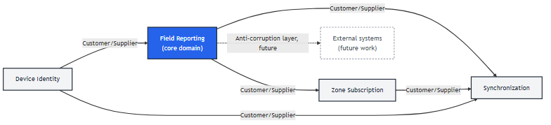
  <figcaption><em>Figure 5: Bounded contexts and their dependencies.</em></figcaption>
</figure>

### 3.2 Event-Based Domain Model

Table 3.2 lists the events an event-storming pass over the four scenarios in Section 2.5 turns up. For brevity: Offline (logging without a connection), Connected (working with a connection), Meeting (two crews meeting), Reconnect (coming back into coverage).

| Event | Scenario | Operation |
|---|---|---|
| Report created | Offline | `CREATE` |
| Report field updated | Offline, Meeting | `SET_FIELD` |
| Incident created | Connected | `CREATE` |
| Incident status changed | Connected | `SET_FIELD` |
| Field marked conflicted | Meeting | derived |
| Conflict resolved by a crew leader | Meeting | `RESOLVE_CONFLICT` |
| Tablet reconnected to server | Reconnect | triggers sync |
| Tablet synced with server | Reconnect, R2 | sync completes |
| Two tablets synced in P2P mode | Meeting | sync completes |
| Position mapped to zones | R6 | derived |
| Report routed to subscribed tablets | Connected, R6 | delivery |

*Table 3.2: Domain events.*

### 3.3 Elaborating Field Reporting

Field Reporting carries our hardest problem: correctly merging concurrent offline edits.

**Ubiquitous language.** We built our own team terminology for the domain concepts [<a href="#7">7</a>]. An **Incident** is one wildfire response effort. A **Report** is one reportable thing inside an incident. An **Event** is one immutable write to one field, by one device. A **dot** pairs a device id with that device's own local sequence number, and the **causal context** stores what a device already has seen, as a map from device id to counter, together they form the Dotted Version Vector (DVV) our merge relies on. A **Tier A field** merges by itself, automatic, no person needed. A **Tier B field** has no safe automatic merge and stays for a crew leader to resolve. A **conflict** happens when two events touch the same Tier B field and neither device knew about the other.

**Tactical DDD.** The entity **Incident** has an immutable `incidentId`. Its `name` is Tier A with a fixed tiebreak rule. Its `status` is Tier B, since a status change is a judgement call, not something automatic. The entity **Report** has immutable `reportId` and `incidentId`. Its `reportType` is Tier A, merged by set union. Its `severity` is Tier A too, merged by taking the maximum. Its `location` and `description` stay Tier B for manual resolution. **Event** is its own category, with `eventId`, `operation` (`CREATE`, `SET_FIELD`, or `RESOLVE_CONFLICT`), `field`, `value`, `dot`, `causalContext`, and `supersedes`. On a resolution, `supersedes` lists the values the crew leader saw when settling the conflict. It is only a record, and the merge does not use it (ADR 4). **Dot** and **causalContext** are value objects, together the DVV. **MergeService** applies the Tier A/B policy. In the code this is the `MergeCore` class of the shared `core` library, which the tablet and the server both run. Every Tier A policy is deterministic, commutative, associative, and idempotent, the CRDT convergence properties, so every device converges regardless of arrival order. On the tablet, the Report, Incident and Event repositories are SQLite repositories over the shared schema (`ReportRepository`, `IncidentRepository`, `EventRepository`). We use no Factory, an Incident or Report is simply created by its first `CREATE` event.

**Resolving a conflict.** A resolution is saved like any other change, with its own dot and causal context. The only difference is that it is allowed on Tier B fields only. Its causal context says which values the device had when the crew leader settled the conflict. Those values are no longer shown, but they stay in the event log, and the resolution becomes the new value. A value the device did not have is still shown. So in three cases a conflict is still shown after a resolution. First, two people settle the same conflict without knowing about each other: neither resolution knows about the other, so the two resolutions become a new conflict. Second, a device settles a conflict before it has received all the conflicting values: the resolution is in conflict with the values it missed. Third, a value written offline before the resolution arrives later: it opens the conflict again. In all three cases nothing is lost, and every device shows the same conflict. ADR 4 explains why we chose this.

<figure>
  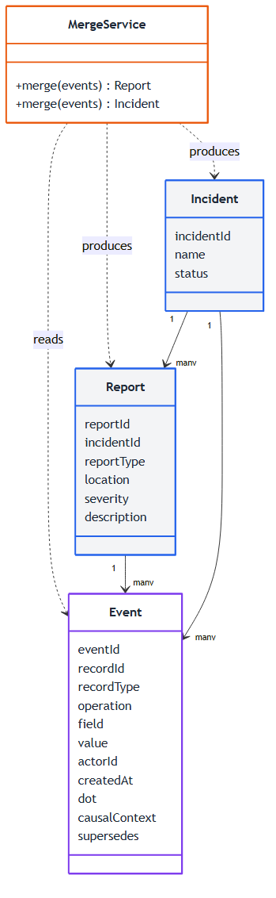
  <figcaption><em>Figure 6: Field Reporting's entities, Event record, and MergeService.</em></figcaption>
</figure>

### 3.4 Container View

The container view opens up the Firefly box from the context view (Figure 1). Firefly runs as five parts, plus the merge code they share.

- **Tablet app.** One per crew, held by the crew leader. It is a native Android app (Kotlin, Jetpack Compose) because Firefly is offline first and cannot depend on a web connection to run. For the same reason it keeps a full copy of the record in a local SQLite store and never needs the server to stay useful (R1).
- **Message broker.** NATS JetStream carries everything between the tablets and the server. Tablets publish their events on the `operation-events` stream, one subject per report or incident (`events.operation.<type>.<id>`), and the server publishes each merged report, as the list of all its events, on a second stream, under `report.<zone>.<reportId>`. JetStream keeps messages until they are read and ignores a message whose id it has seen shortly before. That id is the event's dot, and the server also keeps only one event per dot, so a tablet can resend after a sync was cut off without creating duplicates. Tablets reach it over cellular.
- **ICP server.** A Spring Boot service on the machine at the Incident Command Post. It merges incoming events and works out which zone each report is in. Each tablet picks its own zones from its GPS position, so the server does not track tablets. Zones are cells of H3, a grid that divides the map into hexagons [<a href="#19">19</a>]. The proof of concept still uses a grid of squares in their place (Section 3.7).
- **Server store.** PostgreSQL, with the same logical schema as the tablet store: every event, plus the reports and incidents derived from them.
- **Command web client.** A browser app for command staff at the ICP. It gives them an overview of the entire incident, so they can coordinate the response across crews. It reads the same report stream as the tablets, subscribed to every zone (`report.>`), through NATS over WebSocket since a browser cannot open a plain NATS connection.

The merge code lives in a shared library, `core`, used by both the tablet app and the server. It runs inside both containers, and it is why both sides end up with the same record: they run the same code on the same events (R3).

Everything between a tablet and the server goes through the broker, so a tablet can hand off its events even while the server is busy. Two tablets in P2P mode connect to each other directly, once both crew leaders switch it on (R5).

<figure>
  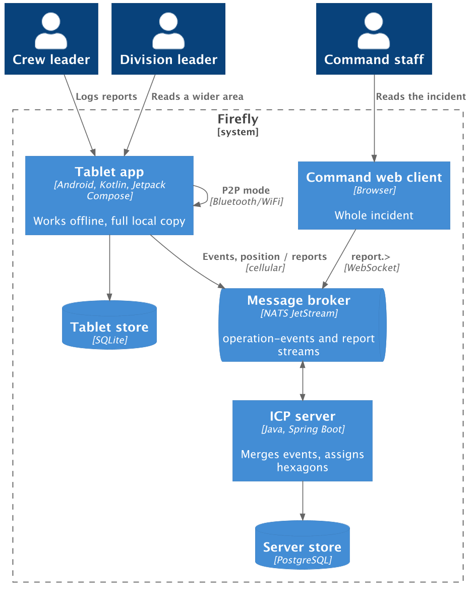
  <figcaption><em>Figure 7: C4 container view.</em></figcaption>
</figure>

### 3.5 Component View

The component view covers the tablet app and the ICP server, which hold most of the logic.

**Tablet app** (Figure 8). The screens only talk to `ReportService`, the one way to change a report. It turns every change into an event, stamps it with the tablet's next dot and its causal context, and stores it together with the derived report in one transaction. A crash cannot leave the two out of step. The local store holds the events, the replica state (the tablet's id, next sequence number and causal context), and the derived reports. The sync client sends the events the broker has not acknowledged yet, and reads the reports for the zones around the tablet's GPS position and around the reports it holds. `P2pManager` finds the other tablet over Nearby Connections. Both hand what they receive to `ReportService`, which merges it with the merge library. An event from the server and one from another tablet take the same path.

<figure>
  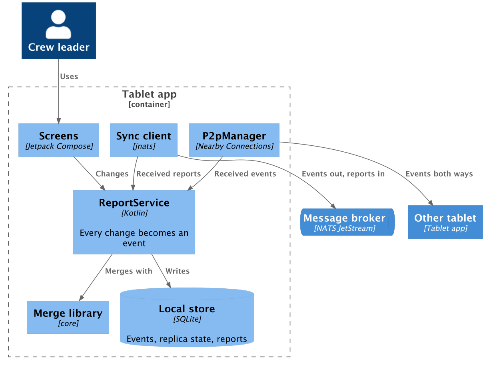
  <figcaption><em>Figure 8: Components of the tablet app.</em></figcaption>
</figure>

**ICP server** (Figure 9). The event consumer reads the `operation-events` stream. `MergeService` applies each event with the same merge library and stores it through the event repository. It then works out the zone of the report from its settled location, and the report publisher puts all of the report's events back on the broker under that zone. The server needs no positions and sends no zone assignments, since each tablet picks its own zones (Section 3.7). Enrolment, left out of the figure, gives each tablet its id when it is set up at the ICP, the id every dot carries.

<figure>
  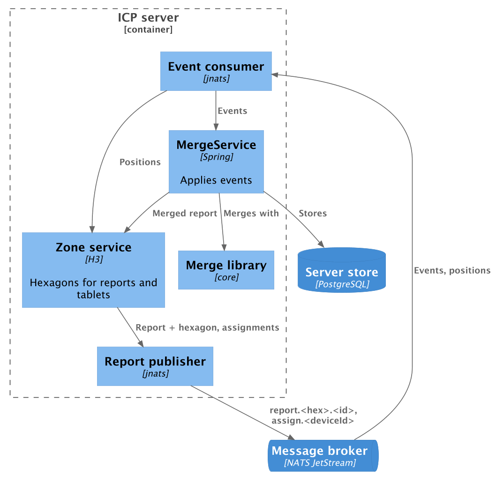
  <figcaption><em>Figure 9: Components of the ICP server.</em></figcaption>
</figure>

### 3.6 Code View

Figure 6 already gives the class level for Field Reporting, the core of the system. The other components are thin enough that a class diagram would add nothing the component view does not show, and one can be generated from the code if needed.

### 3.7 Runtime Views

We follow the scenarios from Section 2.5. The offline one is split in two, since logging and syncing happen at different times.

**Logging without a connection** (Figure 10). Alice's crew loses coverage and she marks a spot fire. `ReportService` stores it as events with her tablet's next dots, and nothing waits on a connection.

<figure>
  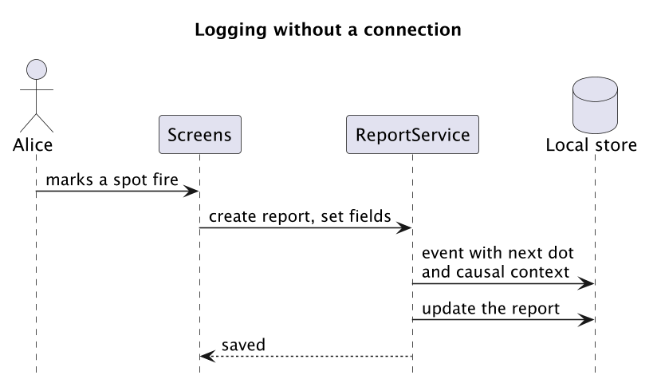
  <figcaption><em>Figure 10: Logging without a connection.</em></figcaption>
</figure>

**Back into coverage** (Figure 11). When cellular coverage returns, the sync client sends every unsent event on `events.operation.<type>.<id>`, where the type is `report` or `incident`, with its dot as message id, and marks it sent once the broker acknowledges it. This includes the events it received from other tablets, so Bob's tablet can carry Alice's spot fire to command. If the connection drops halfway, the next attempt sends the rest again. An event sent twice is still saved once, because NATS drops a repeated message id for a short time and the server keeps one event per dot after that. For each event, the server saves it, reads every event of that record, merges them with the merge library, and rewrites the record and its conflicts in one transaction. If the record is a report that has left its old zone, because its location moved or is no longer settled, the server publishes an empty list under the old zone. If the report has a settled location, the server then publishes all of its events under its zone, where the tablets reading that zone pick it up (Figure 13). The server acknowledges the message only after all of this succeeds, so an event that fails on the way is delivered again.

<figure>
  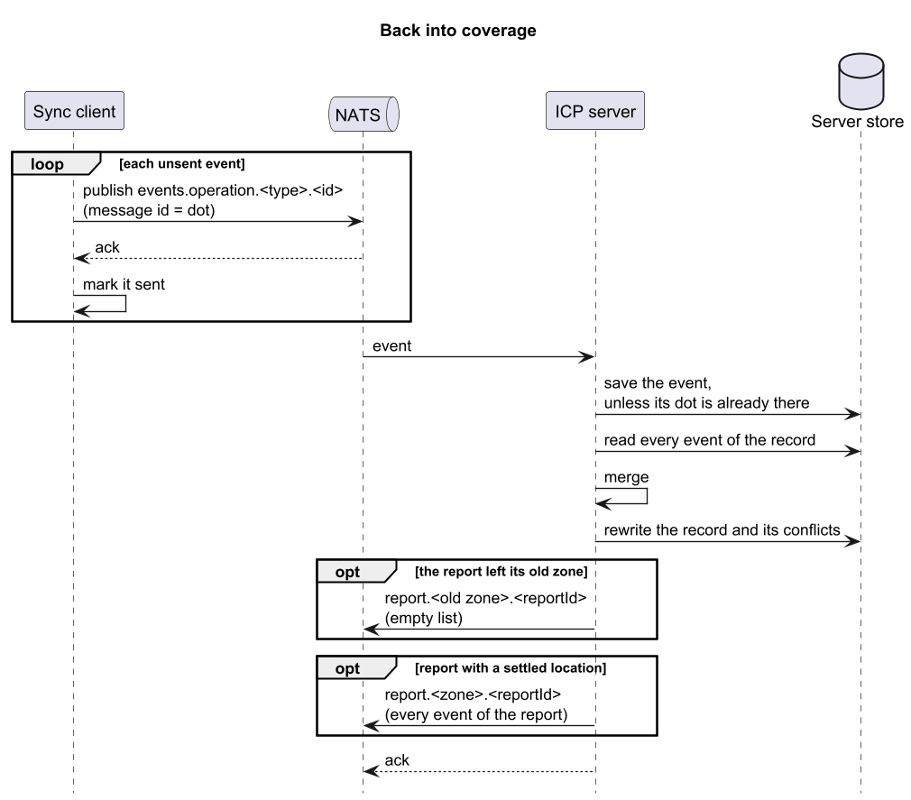
  <figcaption><em>Figure 11: Back into coverage.</em></figcaption>
</figure>

**Two crews meeting** (Figure 12). Alice and Bob both switch on P2P mode and their tablets connect over Nearby Connections. Each sends the events the other has not seen, which it can tell from the other's causal context, and both merge. Conflicts are then resolved as described in Section 3.3.

<figure>
  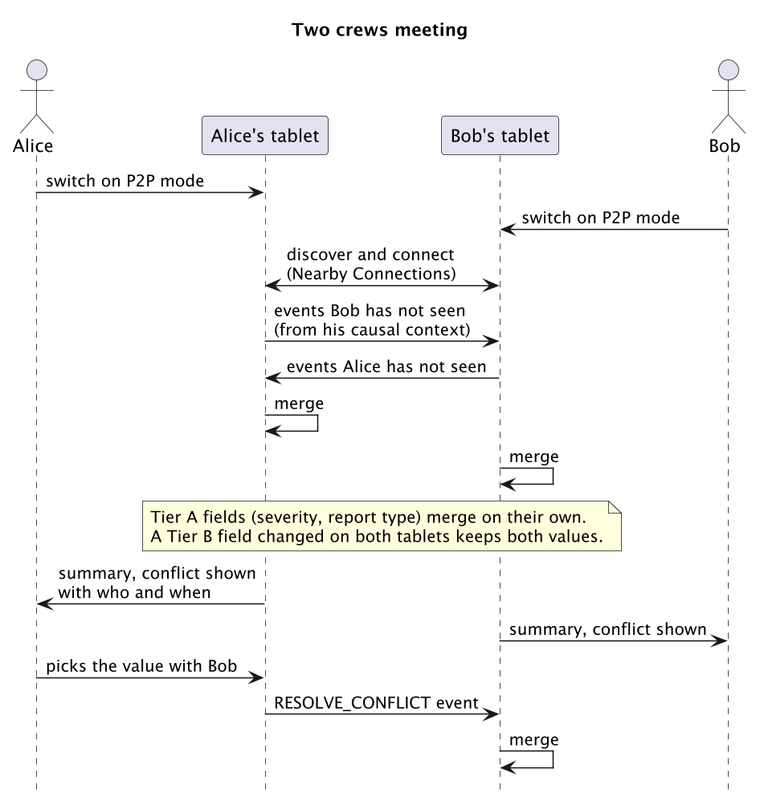
  <figcaption><em>Figure 12: Two crews meeting in P2P mode.</em></figcaption>
</figure>

**Getting the reports for a zone** (Figure 13). Each tablet chooses its own zones. It reads its position from GPS and takes the zone it stands in and the eight zones around it. It adds the zone of every report it holds that has a settled location, again with the eight around it. This way a report just over a border still arrives, and the tablet keeps hearing about its own reports after it moves away. It subscribes to `report.<zone>.*` for all of these zones. NATS keeps only the newest message per report, so the tablet first receives the latest event list of every report in its zones, then each new list the server publishes. It merges each list with its own events, the same way it merges events from another tablet, then works out its zones again and changes its subscription if they changed. An empty list means the report moved to another zone. The tablet ignores it and keeps the report, since a tablet never removes events it holds. In the proof of concept a zone is a square of a fixed grid, 0.05 degrees on each side, in place of an H3 hexagon. A larger radius for division leaders and zones assigned by command are not built yet.

<figure>
  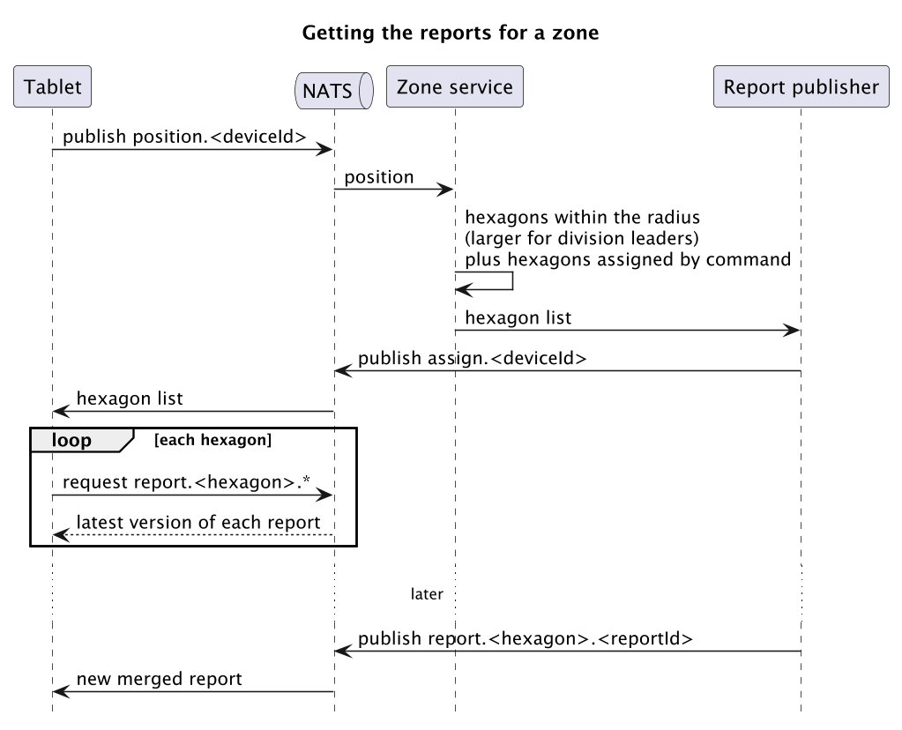
  <figcaption><em>Figure 13: Getting the reports for a zone.</em></figcaption>
</figure>

### 3.8 Deployment View

Firefly runs at the incident itself (Section 2.2). The server side is one physical machine at the Incident Command Post, running the broker, the ICP server and PostgreSQL. Tablets reach that machine over cellular when they have coverage and keep working offline when they do not. Command staff open the web client in a browser on a computer at the post, over the local network.

Tablets need Android 14 or newer, since the tablet store uses SQLite's STRICT tables, which Android only ships from version 14.

If the machine at the ICP goes down, only the server path stops. Tablets keep working and keep syncing with each other, and they catch up with the server once it is back, since every tablet still holds all of its events.

<figure>
  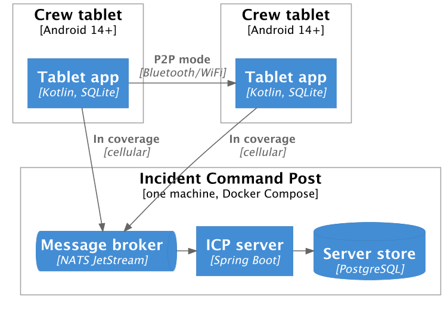
  <figcaption><em>Figure 14: C4 deployment view.</em></figcaption>
</figure>

### 3.9 Architectural Decisions

**We chose a two-tier merge policy instead of one single policy.** An always-automatic policy can silently pick a value nobody chose, hiding a real disagreement. An always-manual policy makes a leader step in on every sync, even for a safe field like severity. Splitting fields by tier gives us both: nothing gets dropped, and only fields where a wrong automatic choice matters need a person.

**Sync has two directions, and both go through NATS.** A tablet sends its events to NATS when it gets a connection. The server reads them, merges them, and saves the result (Section 4.1). The server then sends each merged report back through NATS. A tablet receives only the reports in the zones around its own position and around the reports it holds (Section 4.2).

### 3.10 How This Connects to Chapter 2

Our bounded contexts match the stakeholders from Section 2.3. Field Reporting serves the crews (Offline, Meeting, and Reconnect scenarios). Zone Subscription serves division leaders and command staff (Connected scenario, R6). Table 3.2 models the same four scenarios from Section 2.5 as a domain, not as narrated steps. The Tier A/B split is exactly what R4 needs at the data level, no report is lost, which is the "how" R4 itself points here for.

## 4. Architectural Decision Records

This chapter summarises four decisions: how events get from a tablet to the server, how reports get back, how these events are authenticated, and how a conflict is resolved. Each is recorded in full as its own ADR, linked below.

### 4.1 ADR 1: How Events Travel from Device to Server

Getting events from a tablet to the server has to survive a sync cut off halfway, and a whole division reconnecting within minutes of each other at shift change, without the server becoming the bottleneck. We compared sending events straight over HTTP, writing directly to the database, and two message logs, Kafka and NATS JetStream. We chose NATS JetStream: a tablet gets a confirmation once its events are safely on disk and does not wait for the server to merge them, which is what makes shift change survivable, and it is small enough to run as one more program on the ICP's single machine, unlike Kafka. Full ADR: [How Events Travel from Device to Server](adrs/adr1.md).

### 4.2 ADR 2: How Reports Travel from Server to Device

Delivering new reports back to a tablet has to arrive quickly, without draining a twelve-hour battery, and keep working through the drops typical of a fire. We compared short and long polling, Server-Sent Events, and the NATS JetStream client. We chose the NATS JetStream client: it reuses the connection the tablet already holds for sending events (ADR 1), which already recovers from drops, rather than opening and maintaining a second one just for the other direction. Full ADR: [How Reports Travel from Server to Device](adrs/adr2.md).

### 4.3 ADR 3: How Events Are Authenticated

Firefly has to rule out false or spoofed reports without slowing a crew leader down in the field, and whatever proves a report's origin has to work fully offline, for both the server path and peer-to-peer sync. We weighed an IP/MAC whitelist with a shared secret, a per-device symmetric key with an HMAC per event, mutual TLS on the server connection, and signing each event with a device key pair. We chose per-event signing: it is the only option that covers both sync paths with one mechanism, and removing a lost or compromised device just means removing its public key, with nothing to change on any other tablet. Full ADR: [How Events Are Authenticated](adrs/adr3.md).

### 4.4 ADR 4: How a Conflict Is Resolved

When a Tier B field is in conflict, a crew leader settles it on one device, and every other device must accept that choice too, without hiding a value nobody has seen. The hard case is two people settling the same conflict at the same time without knowing about each other. We compared four options: the resolution lists what it replaces, the latest resolution wins, the higher role wins, or the resolution is a normal change. We chose the normal change: it replaces only the values its device had, so nothing unseen is hidden, and if two people settle a conflict without knowing about each other, both answers are shown as a new conflict. Full ADR: [How a Conflict Is Resolved](adrs/adr4.md).

## 5. Proof of Concept

The proof of concept is the first phase of the roadmap (Section 2.8). We built the riskiest part first: the Wardley Map (Section 2.4) puts Field Reporting, the merge of concurrent offline edits, alone in genesis, and no existing tool does it for us (Section 2.2). Around the merge we built the two paths that carry it, the server path through NATS and P2P mode. The code, and how to run it, is in `poc/`.

### 5.1 What It Has to Show

1. **A tablet stays useful with no connection** (R1, availability under partition).
2. **No edit is lost, and every replica ends up with the same record** (R3, R4, reliability). Table 5.1 breaks this into seven properties.
3. **The server is one more peer** (R2, R3). It runs the same merge code on the same events, and a tablet merges what the server sends like what another tablet sends.

Scalability is measured in the beta (Section 2.7), and compatibility across versions needs a second version, so both are left out.

### 5.2 What We Built

We built three containers of Section 3.4: the tablet app (`device`), the ICP server with its store (`server`), and the merge library both run (`core`). Docker Compose runs NATS JetStream and PostgreSQL next to the server.

Both stores have the same tables and constraints, once as SQLite STRICT tables and once for PostgreSQL. `events` is the only source of truth, every other table is rebuilt from it.

### 5.3 How an Edit Travels

**Logging without a connection.** A screen calls `ReportService`, the only way to change a record. It stamps the change with a random `eventId`, the tablet's next dot and its causal context. In one SQLite transaction it stores the event, advances the replica state and rebuilds the record's row from all of its events, so a crash leaves all of it or none of it. A field that is unknown or in conflict stays empty in the row, and its candidates go in `field_conflicts`. No step on this path makes a network call.

**Two crews meeting.** Both crew leaders tap Start P2P, and each tablet advertises and searches at once over Nearby Connections, so neither side is the host. Each sends its causal context, and the other answers with every event that context does not cover. That includes events it got from other tablets, so a report reaches a crew that never met its author. The receiver stores an event only if its `eventId` and dot are new, and rebuilds the records it touched. A Tier B conflict shows each value with who wrote it and when. The crew leader settles it with Keep this or an agreed wording, a `RESOLVE_CONFLICT` that covers the values on screen. If another value arrived meanwhile, the tablet refuses, since it would settle a value nobody looked at.

**Back into coverage.** After Connect on the Server tab, the tablet publishes every event it holds, then each new one, including those from other tablets, so a tablet with signal relays for one without. Each goes on `events.operation.<record type>.<record id>` with its dot as message id. The server reads them through a durable consumer, so nothing is lost while it is down. In one PostgreSQL transaction it inserts the event if it is new, replays the record's events through `core` and rewrites the row by the tablet's rule. It then publishes the report on `report.<zone>.<reportId>`, in a stream that keeps the latest message per subject, so a tablet joining a zone gets every report in it.

The server publishes a report as all of its events rather than its merged row, because a merged row cannot be merged again: a tablet that knows something the server does not would have to pick one version. Events merge with whatever the tablet holds, through the same path as P2P.

### 5.4 How We Checked It

Claim 1 holds by construction (Section 5.3). For claims 2 and 3 there are 151 automated tests, 84 in `core`, 50 in `device` and 17 in `server`. The central one, `MergeLawsTests`, generates 300 random histories. In each, four simulated tablets with clocks three hours apart make 40 edits to three records and now and then receive each other's logs. `TierATests` and `TierBTests` pin each field's policy, and `EdgeCaseTests` covers unusual cases such as a write that arrives before its create. Two of the edge cases are disabled on purpose and mark known gaps, for example the same description typed on two tablets still shows as a conflict. The tablet's database tests run on Robolectric, and `MergeServiceTests` runs the server against the real schema in a throwaway PostgreSQL through Testcontainers. Table 5.1 maps them to claim 2.

| Property | Evidence |
|---|---|
| No silent loss | Events are never changed, an event and its row are written together, and a Tier B field keeps every concurrent value (`TierBTests`). |
| Convergence | All four simulated tablets end with the same record, equal to a rebuild from their logs. The server runs the same `core` (`MergeServiceTests`). |
| Duplicate safety | A doubled log changes nothing. Both stores keep one copy of an event sent twice. |
| Order independence | Ten shuffles of each history give the same record. Merging is commutative, associative and idempotent. |
| Path independence | Histories mix direct and relayed delivery, and tablets pass on everything they hold. |
| Clock independence | The simulated clocks are hours apart. System time is only displayed. |
| Conflict visibility | A Tier B conflict stays until one resolution covers every value, and concurrent resolutions form a new conflict (`TierBTests`). |

*Table 5.1: The seven properties behind claim 2. Rows without a test name come from `MergeLawsTests`.*

On devices, a Galaxy S25 Ultra and a Galaxy Tab S8+ sent each other severity changes over P2P, and so did two emulators. A Galaxy S24 and the S25 Ultra ran both experiments of Chapter 6, and in Experiment 2 every log arrived with nothing lost and no duplicates.

### 5.5 Where It Differs from the Architecture

The shortcuts sit around the merge, not in it. The MVP has to close them.

- **Zones.** A zone is a 0.05° grid cell, about 5.5 km north to south, not an H3 hexagon [<a href="#19">19</a>]. `Zone` is one class, so swapping it is local. A tablet's position is a fixed point in the code, not a GPS reading, so every tablet listens around the same spot plus around the reports it holds (Section 3.7). The larger radius for division leaders and zones assigned by command (R6) are not built. Incidents have no location and so no zone, so they travel only over P2P.
- **Server sync.** The crew leader taps Connect instead of the tablet noticing coverage (R2). The tablet keeps no sent mark (Section 3.7) and sends everything again on each connect.
- **Trust.** A tablet makes its own id, events are not signed (ADR 3), and P2P accepts any tablet that has P2P on. R5 asks that tablets trust each other on request, for example by both crew leaders confirming the short code Nearby Connections shows on each side. This is acceptable only because the proof of concept is never deployed.
- **Missing parts.** There is no command web client. Every change replays the record's whole history, which is simple but grows with the record.

### 5.6 What Building It Taught Us

**Sharing `core` is what makes the server a peer.** The server has no merge logic of its own, so it cannot disagree with a tablet, and a merge bug fixed once is fixed on both sides.

**Idempotence belongs in the stores, not the broker.** Our first design counted on JetStream ignoring a message id it has already seen. It does so only within its duplicate window, two minutes by default [<a href="#24">24</a>], so a resend after a longer gap is stored twice in the stream. The record stays right because both stores keep an event once, by its `eventId` and dot. The broker's check saves work, it does not make the result correct.

**Tier B reaches beyond the merge.** A disputed location gives a report no zone, so the server publishes it nowhere until a crew leader settles it, and a tablet that did not already hold it cannot get it from the server. The MVP has to decide where such a report shows up, for example in the zone of every candidate.

**Severity can only rise.** The maximum converges without anyone deciding, but a crew leader who typed 9 instead of 4 cannot take it back (`TierATests`). Field trials should show whether that is acceptable.

## 6. Architectural Experiments

Two of our decisions are based on what we expect, not on data. So we test each one with an experiment. The results will confirm a decision or change it. For Heron both experiments are designed and each has a first result. Appendix B has the details.

### 6.1 Experiment 1: How far does the P2P link reach?

We use Nearby Connections for P2P between tablets [<a href="#18">18</a>]. We chose it from the documentation, not from data. This matters for R5, where two crews meet and sync. The question is how far apart two devices can be and still receive each other's changes.

We did a walking test with a Galaxy S25 Ultra and a Galaxy S24 in clear line of sight. The S24 sent severity changes all the time while its owner walked away in a straight line. The changes kept arriving until the phones were ~50-60m apart. This is only our estimate, because we did not measure it. Next we repeat the walk with marked distances.

We keep Nearby Connections if the changes arrive at 10m, because crews meet face to face. If not, we test Wi-Fi Direct. The whole logs we sent in Experiment 2 also arrived complete at ~10m and ~20m, in clear line of sight at the same place as the walking test.

### 6.2 Experiment 2: How long does a sync take?

Section 3.3 explains the causal context. In the sync in Section 3.7 a tablet sends only the events the other tablet does not have. We call this the causal-context way. The simple way is to send the whole log. The causal-context way sends less, but it needs one more message and more code. The question is whether it is worth it. This matters for R3 and for the scalability target in Section 2.7.

We send a whole log of 10,000 events from a Galaxy S24 to a Galaxy S25 Ultra over P2P and time it. We did this three times, at ~1m, ~10m and ~20m. The S25 Ultra stored all 10,000 events each time in ~0.8-1.2 s, with nothing lost and no duplicates.

We keep the causal-context way if sending the whole log takes more than one minute. It took ~1 s, so on this link the simple way is enough. We still have to test a weak link at the edge of the range.

### 6.3 Limits and next steps

We used only Samsung devices. The walk was in clear line of sight, which is the best case on a fireground. A good result does not prove a decision is right. It only shows it is not wrong. The timing comes from one pair of devices. More measurements come before the Swan release.

## References

<a id="1">[1]</a> Los Angeles Fire Department, "Palisades Fire After-Action Review Report," Lafd.org, Oct. 8, 2025. https://lafd.org/sites/default/files/pdf_files/Palisades_AARR_10_08_2025_final.pdf (accessed Sep. 21, 2026)

<a id="2">[2]</a> Firehouse, "LAPD: Lack of Unified Command Led to Chaos During Palisades Fire," Firehouse.com, Nov. 2025. https://www.firehouse.com/california-fire-storm/news/55328119/lack-of-unified-command-led-to-chaos-during-palisades-fire-probe-shows (accessed Sep. 20, 2026)

<a id="3">[3]</a> Santa Monica Daily Press, "LAFD report calls for major changes after devastating Palisades Fire," Smdp.com, Oct. 2025. https://www.smdp.com/lafd-report-calls-for-major-changes-after-devastating-palisades-fire (accessed Sep. 20, 2026)

<a id="4">[4]</a> Wikipedia, "2002 Überlingen mid-air collision," Wikipedia.org. https://en.wikipedia.org/wiki/2002_%C3%9Cberlingen_mid-air_collision (accessed Sep. 20, 2026)

<a id="5">[5]</a> The Local, "Opinion: As French wildfires still burn, the blame-the-Greens deflection has begun," Thelocal.fr, Aug. 5, 2026. https://www.thelocal.fr/20260805/opinion-as-french-wildfires-still-burn-the-blame-the-greens-deflection-has-begun (accessed Sep. 20, 2026)

<a id="6">[6]</a> Notre-Planète, "Incendies de juillet 2026 en Gironde : le plus vaste feu de forêt en France depuis 1949," Notre-planete.info, Aug. 12, 2026. https://www.notre-planete.info/actualites/506-feux-foret-incendie-Gironde-juillet-2026 (accessed Sep. 20, 2026)

<a id="7">[7]</a> A. van Deursen, "Problem Analysis, Part II," CS4505 Software Architecture, Lecture 5, Delft University of Technology, Sep. 2026.

<a id="8">[8]</a> A. Cockburn, *Writing Effective Use Cases*. Boston, MA: Addison-Wesley, 2001.

<a id="9">[9]</a> SolTech, "Software Support and Maintenance Costs." Soltech.net. https://soltech.net/software-support-and-maintenance-costs/ (accessed Sep. 21, 2026)

<a id="10">[10]</a> Licenseware, "Software Vendor Price Increases in 2025." Licenseware.io. https://licenseware.io/software-vendor-price-increases-in-2025/ (accessed Sep. 21, 2026)

<a id="11">[11]</a> A. van Deursen, "Problem Analysis, Part I," CS4505 Software Architecture, Lecture 2, Delft University of Technology, Sep. 2026.

<a id="12">[12]</a> Confluent, "Confluent Platform System Requirements." Docs.confluent.io. https://docs.confluent.io/platform/current/installation/system-requirements.html (accessed Oct. 11, 2026)

<a id="13">[13]</a> Confluent, "Confluent REST Proxy for Apache Kafka." Docs.confluent.io. https://docs.confluent.io/platform/current/kafka-rest/index.html (accessed Oct. 11, 2026)

<a id="14">[14]</a> NATS, "JetStream." Docs.nats.io. https://docs.nats.io/nats-concepts/jetstream (accessed Oct. 11, 2026)

<a id="15">[15]</a> NATS, "What is NATS." Docs.nats.io. https://docs.nats.io/nats-concepts/what-is-nats (accessed Oct. 11, 2026)

<a id="16">[16]</a> NATS, "Connect over WebSocket." Docs.nats.io. https://docs.nats.io/running-a-nats-service/configuration/websocket (accessed Oct. 11, 2026)

<a id="17">[17]</a> NATS, "Authenticating with an NKey." Docs.nats.io. https://docs.nats.io/running-a-nats-service/configuration/securing_nats/auth_intro/nkey_auth (accessed Oct. 11, 2026)

<a id="18">[18]</a> Google, "Nearby Connections overview," Developers.google.com. https://developers.google.com/nearby/connections/overview (accessed Oct. 11, 2026)

<a id="19">[19]</a> H3, "Introduction." H3geo.org. https://h3geo.org/docs/ (accessed Oct. 13, 2026)

<a id="20">[20]</a> Esri, "Go off the grid with ArcGIS Pro: Offline editing with sync enabled feature services," ArcGIS Blog, Esri.com. https://www.esri.com/arcgis-blog/products/arcgis-pro/data-management/off-the-grid-arcgis-pro (accessed Oct. 23, 2026)

<a id="21">[21]</a> Esri, "Using sync," ArcGIS REST APIs, Developers.arcgis.com. https://developers.arcgis.com/rest/services-reference/enterprise/using-sync/ (accessed Oct. 23, 2026)

<a id="22">[22]</a> Meshtastic, "ATAK Plugin," Meshtastic.org. https://meshtastic.org/docs/software/integrations/integrations-atak-plugin/ (accessed Oct. 23, 2026)

<a id="23">[23]</a> S. W. Miller, "This small mesh networking device from goTenna could unblock signal-denied warfare environments," Armada International, Sep. 9, 2019. https://www.armadainternational.com/2019/09/this-small-mesh-networking-device-from-gotenna-could-unblock-signal-denied-warfare-environments/ (accessed Oct. 23, 2026)

<a id="24">[24]</a> NATS, "Your first stream," Docs.nats.io. https://docs.nats.io/nats-concepts/jetstream/streams (accessed Oct. 26, 2026)