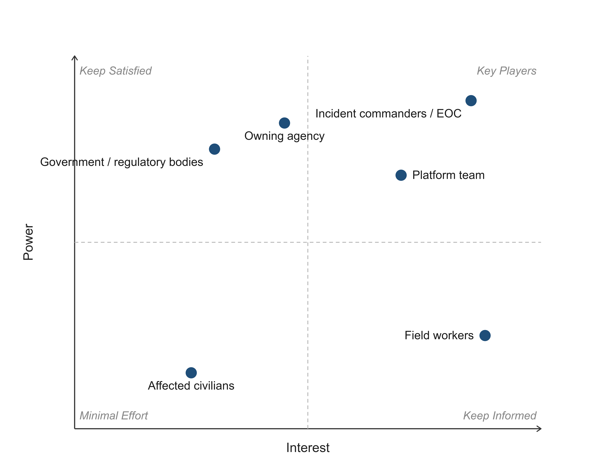

## 1. Introduction

In today's world, climate change has made once-in-a-lifetime natural disasters a common occurence. First responders have to deal with situations that greatly exceed normal operations, in hostile environments where connectivity is unreliable or absent for extended periods of time. Supervisors coordinating relief efforts deal with immense workloads in contexts in which human life is at stake, made worse by the fact that the same communication channels used to issue orders are also carrying field reports up the command chain. This problem, and how it has broken down in the past, is explored more throughly in Chapter 2. 

To relieve part of this workload, we propose Firefly, a mobile and web application that lets emergency personnel record and edit structured reports about an ongoing incident directly from the field. The system is offline-first: personnel can create and edit reports with no connectivity at all, and a backend reconciles conflicting edits once connectivity is restored. Because more than one person may edit the same report while both are offline, a thorough conflict-resolution and merging policy was designed and evaluated specifically to avoid discarding safety-critical information. Furthermore, to ensure that emergency personnel have access to the most complete and recent information, even in low connectivity scenarios, we included peer-to-peer synchronization between devices deployed in the field that enter eachother's range.

The architecture of the proposed system is explored in Chapter 3, and the results of a varied set of experiments are outlined in Chapter 4. Finally, a conclusion and a discussion of the future roadmap is presented in Chapter 5.

## 2. Problem and Context Analysis

### 2.1 Problem Description

During large-scale natural disaster response, coordination runs primarily through a single radio channel, used both to relay information up the chain and to issue orders back down. [[1]](#1)[[2]](#2) Under pressure this channel becomes overcrowded, leading to mismanagement and other failures: congested radio frequencies and a fractured command structure during the Pacific Palisades Fire (2025) [[3]](#3)[[4]](#4)[[5]](#5), and a public dispute over resource allocation during the Gironde wildfires in France (2026), though no official review has yet confirmed its cause. [[7]](#7)[[8]](#8)

The same overload falls on the small group of people responsible for coordinating a response, and overworking them can have disastrous consequences: in the 2002 Überlingen mid-air collision, a single air traffic controller managing two positions alone failed to separate two aircraft in time, killing all 71 people aboard. [[6]](#6)

We therefore introduce Firefly, a system that lets field workers share incident reports even when the usual communication channels are overloaded, merging conflicting or overlapping reports in cases where this is achievable without loss of information, in order to help reduce and optimize effort during a natural disaster response.

### 2.3 Stakeholders

Stakeholders fall into five categories. Field workers (firefighters, crew leads) create and edit reports and have the most direct daily contact with the system, but hold no formal power over its design or deployment. Command and decision-making staff, like incident commanders or EOC (Emergency Operations Center) personnel consume the merged view and are the primary reason the system exists. The owning agency, such as a regional fire or other emergency management service controls procurement, deployment, and data governance. Above them sit the governement and regulatory bodies, such as national ministries or civil authorities and data protection regulators. They have high power, set policy, funding, and compliance requirements without using the system themselves, and are not always aligned with the owning agency, as the resource-allocation dispute between Gironde's fire service and France's Interior Ministry proves. The platform developers design and improve the system. Indirectly affected parties, such as civilians named in reports, and any data-protection or oversight body, have a stake in how the system behaves without using it directly.

Plotting the each stakeholder in a Power/Interest grid helps to shed light on what aspects of our solution deserve the highest amount of focus and highlights any possible conflicts.

<figure>
  
  <figcaption><em>Figure 2: Power-Interest Grid for Stakeholders</em> </figcaption>
</figure>

### 2.7 Ethical and Legal Considerations

- Automation bias. A commander who sees a report marked "merged successfully" may stop treating it as provisional. Because the system's entire premise is reconciling conflicting edits where possible without asking a human every time, the UI must keep surfacing that a report was auto-merged, not just that it was saved. Presenting a merge as more certain than it is would undermine the same trust the project is trying to protect. Our solution must never lose information that might be safety critical.
- False or spoofed reports. A system built to keep functioning through network chaos is also an attractive target for someone who wants to inject false situational data during exactly that chaos. Access to this system must be safeguarded by a modern type of user/device authentication.
- Privacy of people named in reports. Reports tied to a location and an incident may name real people or include personally identifiable information such as: injuries, missing persons, property loss. This is sensitive personal data under regulations such as the GDPR, which constrains retention, who can access merge history, and how long conflicting (pre-merge) versions of a report should be kept.
- Equity across device capability. Not every field worker or agency has the newest hardware. The final implementation must be lean and performance optimized such that it can run on a large variety of devices.

## References

<a id="1">[1]</a> National Park Service, "Wildland Fire: Incident Command System," Nps.gov. https://www.nps.gov/articles/wildland-fire-incident-command-system.htm (accessed Sep. 20, 2026)

<a id="2">[2]</a> ScanCal, "Communications and ICS," Scancal.org. https://scancal.org/calfire/ics/communications.html (accessed Sep. 20, 2026)

<a id="3">[3]</a> Los Angeles Fire Department, "LAFD Releases January 2025 Palisades Fire After-Action Review Report," Lafd.org, Oct. 8, 2025. https://lafd.org/alert/lafd-releases-january-2025-palisades-fire-afteraction-review-report-10082025 (accessed Sep. 20, 2026)

<a id="4">[4]</a> Firehouse, "LAPD: Lack of Unified Command Led to Chaos During Palisades Fire," Firehouse.com, Nov. 2025. https://www.firehouse.com/california-fire-storm/news/55328119/lack-of-unified-command-led-to-chaos-during-palisades-fire-probe-shows (accessed Sep. 20, 2026)

<a id="5">[5]</a> Santa Monica Daily Press, "LAFD report calls for major changes after devastating Palisades Fire," Smdp.com, Oct. 2025. https://www.smdp.com/lafd-report-calls-for-major-changes-after-devastating-palisades-fire (accessed Sep. 20, 2026)

<a id="6">[6]</a> Wikipedia, "2002 Überlingen mid-air collision," Wikipedia.org. https://en.wikipedia.org/wiki/2002_%C3%9Cberlingen_mid-air_collision (accessed Sep. 20, 2026)

<a id="7">[7]</a> The Local, "Opinion: As French wildfires still burn, the blame-the-Greens deflection has begun," Thelocal.fr, Aug. 5, 2026. https://www.thelocal.fr/20260805/opinion-as-french-wildfires-still-burn-the-blame-the-greens-deflection-has-begun (accessed Sep. 20, 2026)

<a id="8">[8]</a> Notre-Planète, "Incendies de juillet 2026 en Gironde : le plus vaste feu de forêt en France depuis 1949," Notre-planete.info, Aug. 12, 2026. https://www.notre-planete.info/actualites/506-feux-foret-incendie-Gironde-juillet-2026 (accessed Sep. 20, 2026)
